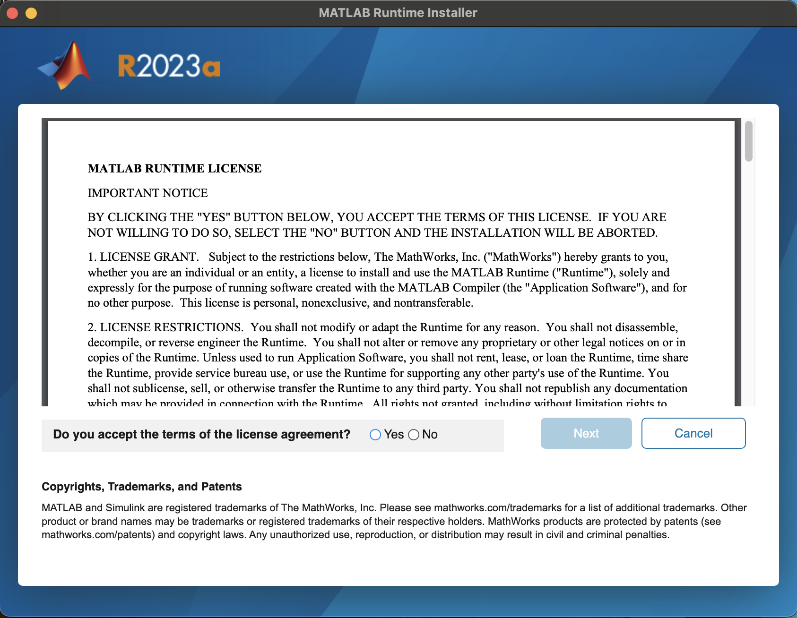
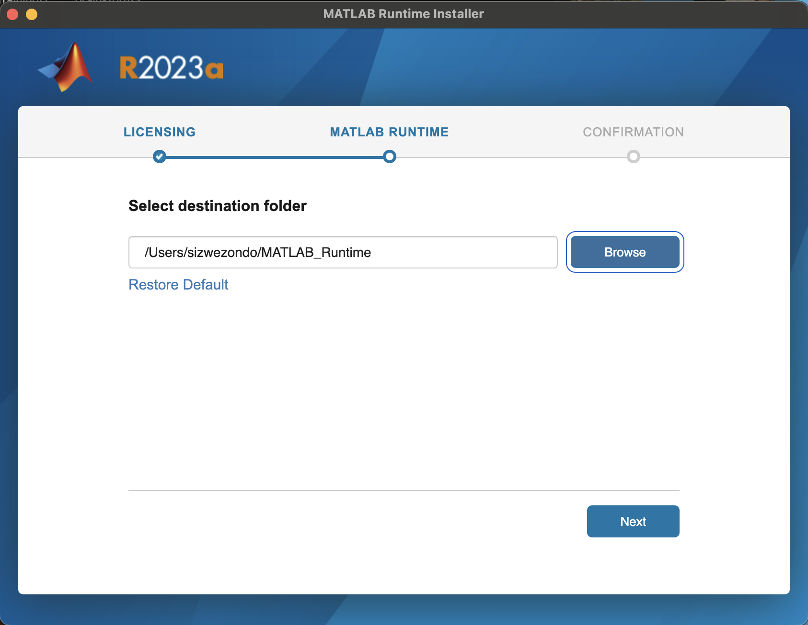
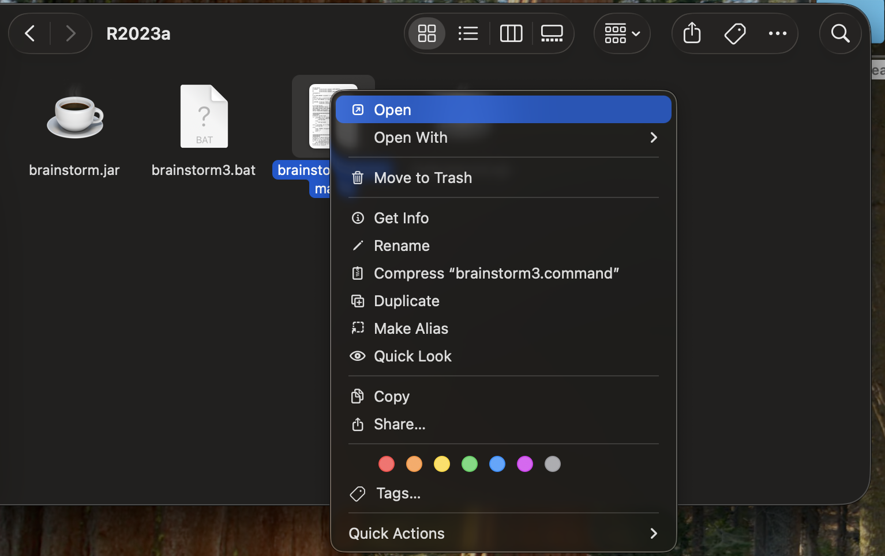
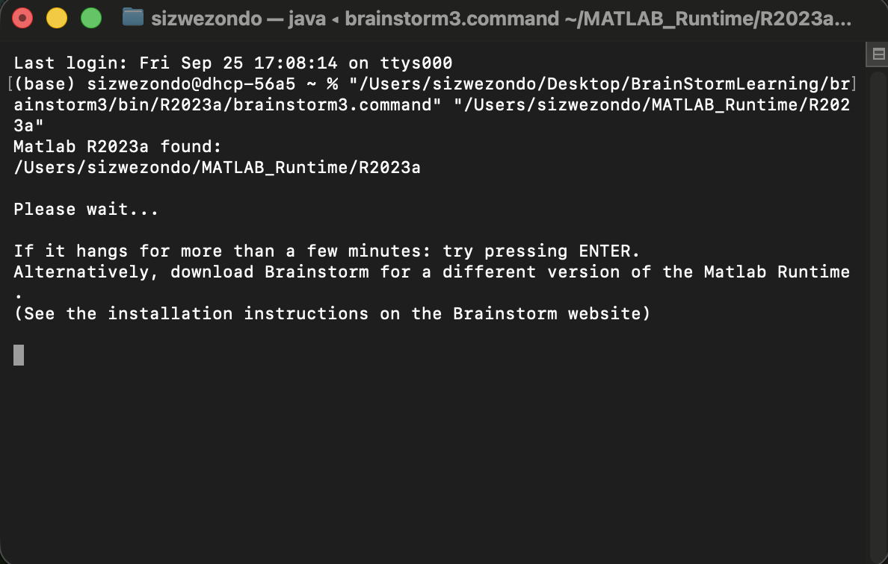
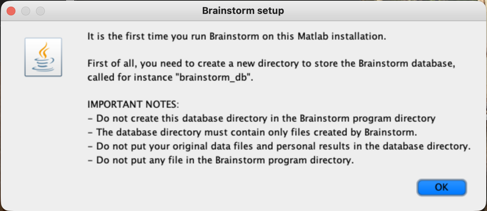
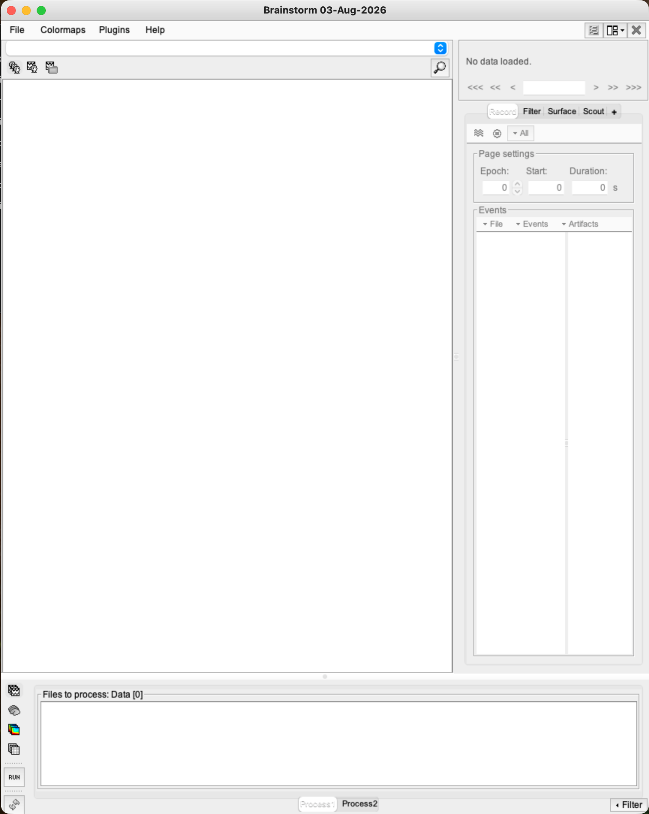
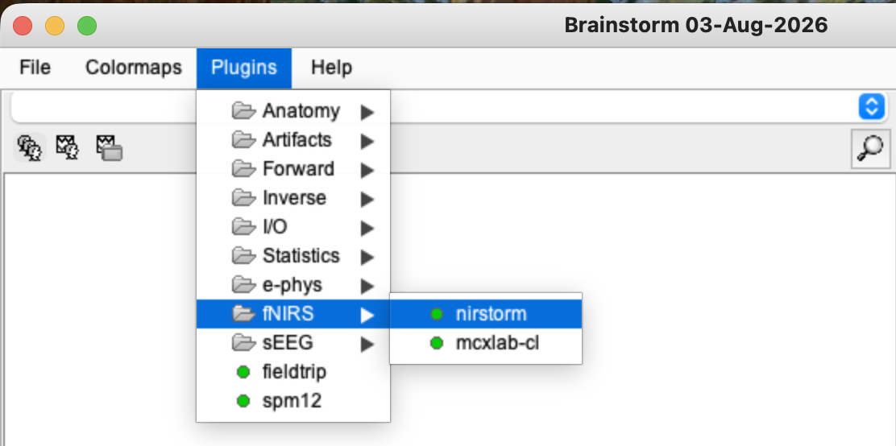
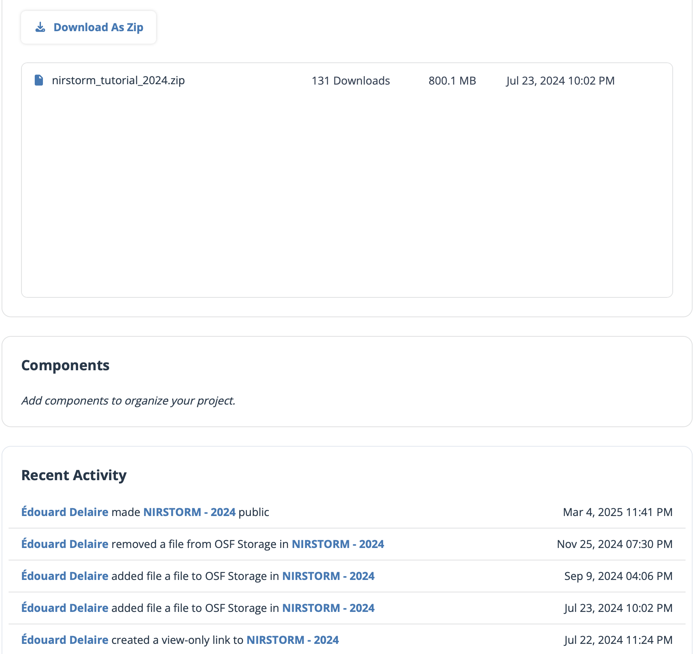
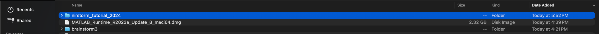
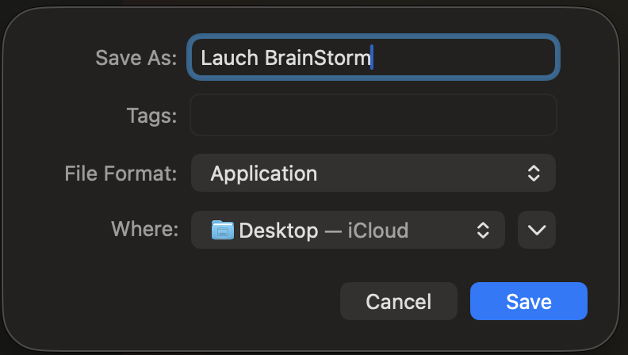

# Lesson 1 — Setup and orientation

<strong>Status</strong> Complete

<strong>Product</strong> Working Brainstorm/NIRSTORM installation

<strong>Platform</strong> macOS and Windows

## Aim

Install the standalone Brainstorm application, confirm that NIRSTORM is available, organise the database and tutorial files correctly, and recognise the main areas of the interface.

## 1. Create the learning folders

Create one main folder, such as `BrainStormLearning`, then create separate locations for:

- `brainstorm3` — the Brainstorm program;
- `MATLAB_Runtime` — the matching runtime;
- `brainstorm_db` — files managed by Brainstorm;
- `tutorial_data` — the downloaded and extracted tutorial data;
- `outputs` — exported figures and notes.

!!! warning "Keep these locations separate"
    Do not place the database or original tutorial data inside the `brainstorm3` program folder. The database folder should contain only files created and managed by Brainstorm.

## 2. Install the standalone application

1. Download the **Brainstorm binary/standalone distribution**, rather than the MATLAB source version.
2. Extract the complete `brainstorm3` folder into your learning folder. Do not copy only one executable: the subfolders are required.
3. Open `brainstorm3/bin` and identify the runtime release supplied with the build. Our tutorial installation used **R2023a**.
4. Download and install the matching **MATLAB Runtime R2023a** for your operating system.
5. Start Brainstorm using the launcher supplied inside the matching runtime folder.

*Figure 1.1. Accept the MATLAB Runtime licence before continuing with installation.*

*Figure 1.2. Keep the default runtime location unless your institution requires a different applications folder.*

!!! info "Operating-system note"
    On macOS, the launcher used in our installation was `brainstorm3/bin/R2023a/brainstorm3.command`. On Windows, open the corresponding `R2023a` folder and run the supplied Windows Brainstorm launcher. Security prompts may appear on the first launch; approve only the Brainstorm files you intentionally downloaded.

*Figure 1.3. On macOS, right-click the command file and select **Open** the first time if Gatekeeper blocks a normal double-click.*

*Figure 1.4. The standalone launcher may open Terminal and request the matching MATLAB Runtime location during first setup.*

## 3. Select the Brainstorm database

On the first launch, Brainstorm asks for a database directory.

1. Read the database warning and select **OK**.
2. Choose the empty `brainstorm_db` folder created earlier.
3. If macOS asks for permission to access Desktop or Documents, select **Allow** when the learning folder is stored there.

*Figure 1.5. The database must be separate from the program and original data folders.*

## 4. Confirm that Brainstorm opens

The main interface should contain:

- the protocol selector and database tree on the left;
- the **Record**, **Filter**, **Surface** and **Scout** tabs on the right;
- the **Files to process** panel and **Process1/Process2** areas at the bottom.

*Figure 1.6. A successful first launch may show an empty database and “No data loaded”.*

## 5. Confirm the NIRSTORM extension

1. In the top menu, select **Plugins**.
2. Move to **fNIRS**.
3. Confirm that **nirstorm** is listed and shows a green status indicator.
4. If it is not installed, select it and follow Brainstorm's installation prompt, then restart Brainstorm if requested.

*Figure 1.7. NIRSTORM supplies the fNIRS-specific processes used in later lessons.*

## 6. Download and extract the tutorial data

1. Open the official NIRSTORM tutorial data page.
2. Download `nirstorm_tutorial_2024.zip`—the archive is approximately **800 MB**.
3. Move the archive into `tutorial_data` and extract it.
4. Confirm that the extracted folder contains BIDS-style files and folders, including `dataset_description.json`, `participants.tsv`, `derivatives` and `sub-01`.

*Figure 1.8. Download the tutorial ZIP rather than each internal file separately.*

*Figure 1.9. The extracted folder contains participant data and dataset-description files.*

## 7. Optional one-click launcher on macOS

If you do not want to start Brainstorm from Terminal each time, create an Automator application that runs the Brainstorm command, then save it as **Launch BrainStorm**. This launcher is only a convenience; it does not contain the database or analysis results.

*Figure 1.10. An optional Automator application can provide one-click startup.*

## Troubleshooting

| Problem | Check |
|---|---|
| Brainstorm does not start | Confirm that the Brainstorm build and MATLAB Runtime release match. |
| First launch seems slow | Allow time for runtime initialisation and cache creation. |
| Database prompt reappears | Select the separate `brainstorm_db` folder, not `brainstorm3` or `tutorial_data`. |
| NIRSTORM menus are absent | Check **Plugins → fNIRS → nirstorm**, install it, and restart Brainstorm. |
| Tutorial data looks incomplete | Extract the entire ZIP and keep its internal folder structure. |

## Checkpoint

Before continuing, confirm that Brainstorm opens, the database folder is recognised, **Plugins → fNIRS → nirstorm** is available, and the extracted tutorial folder contains `sub-01`.

## Self-check {.quiz}

**1. What does NIRSTORM add to Brainstorm?**  
A. A spreadsheet editor  
B. fNIRS-specific processing and reconstruction  
C. MRI acquisition

Reveal answer after attempting
<strong>B.</strong> NIRSTORM supplies fNIRS-specific processes within Brainstorm.

**2. Why must the MATLAB Runtime release match the Brainstorm binary?**  
A. The standalone build was compiled for that runtime  
B. It determines the number of optodes  
C. It stores the event markers

Reveal answer after attempting
<strong>A.</strong> The compiled application requires its matching runtime release.

**3. Which folder should Brainstorm use as its database?**  
A. The `brainstorm3` program folder  
B. The original `tutorial_data` folder  
C. The separate, initially empty `brainstorm_db` folder

Reveal answer after attempting
<strong>C.</strong> Brainstorm-managed files belong in the separate database directory.

**4. What should you do if NIRSTORM is not listed as installed?**  
A. Install it through **Plugins → fNIRS → nirstorm**  
B. Rename the SNIRF file  
C. Delete the MATLAB Runtime

Reveal answer after attempting
<strong>A.</strong> NIRSTORM is managed through Brainstorm's Plugins menu.

**5. Why should the complete tutorial ZIP be extracted?**  
A. Brainstorm requires only the largest file  
B. The dataset depends on its internal BIDS-style folder structure  
C. Extraction changes the sampling rate

Reveal answer after attempting
<strong>B.</strong> Participant data, derivatives and description files must remain organised together.

