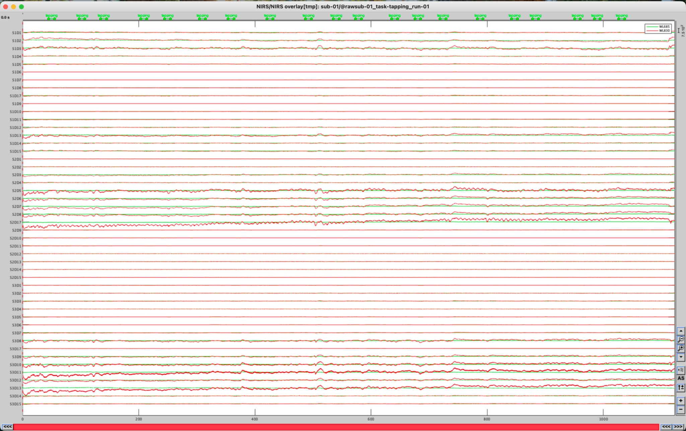
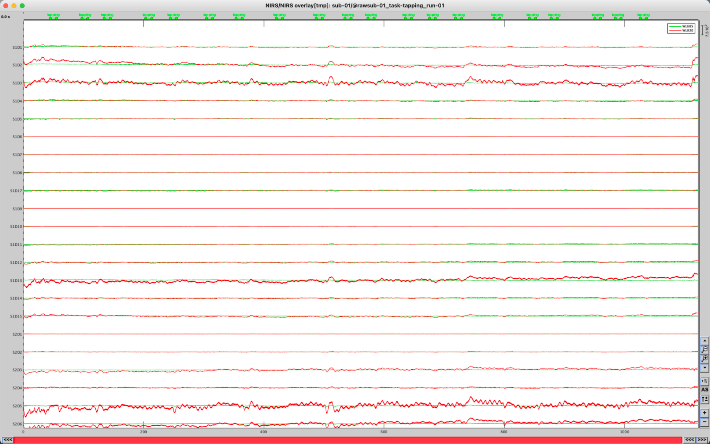
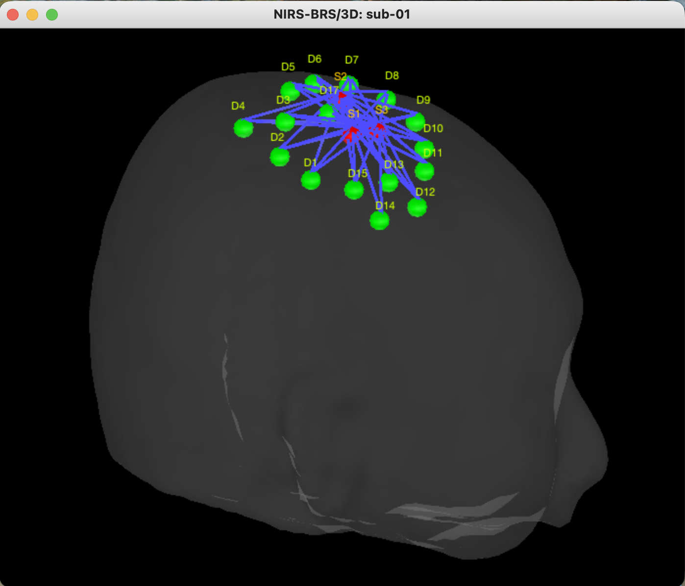
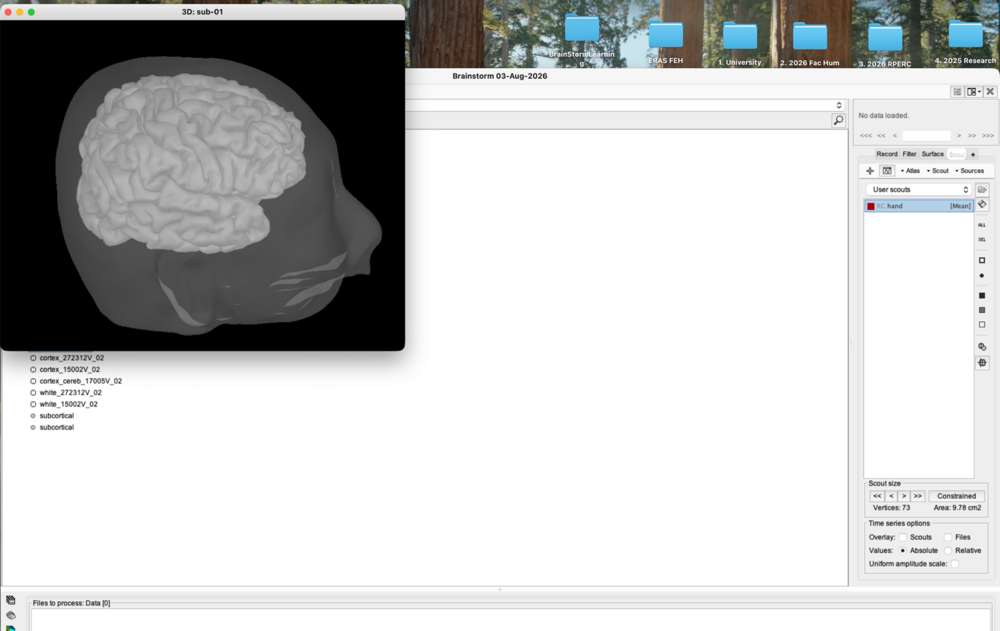

# Lesson 2 — Understanding the experiment

<strong>Status</strong> Complete

<strong>Product</strong> Analysis plan

<strong>Paradigm</strong> Finger tapping

## Aim

Connect the experimental design, montage and expected physiology to the signals that will be inspected and processed in the later lessons.

## 1. Summarise the experiment

| Feature | Tutorial dataset |
|---|---|
| Participant | One participant (`sub-01`) |
| Task | Left-hand finger tapping |
| Blocks | 20 |
| Tapping duration | 10 seconds per block |
| Rest intervals | Variable, approximately 30–60 seconds |
| Recording duration | 1123.2 seconds—approximately 18 minutes 43 seconds |
| Sampling rate | 10 Hz |
| Sources | 3 dual-wavelength sources |
| Detectors | 15 standard detectors plus 1 proximity detector |
| Wavelengths | 685 nm and 830 nm |
| Expected cortical target | Right motor-hand region |

## 2. Understand the block design

The recording alternates between **tapping blocks** and longer **rest periods**. The tapping markers identify when each 10-second motor block begins and ends. Later, these markers allow us to create comparable epochs and calculate a block average.

*Figure 2.1. Green markers above the traces show the 20 tapping blocks across the run.*

*Figure 2.2. The experimental design is embedded in one continuous recording rather than stored as 20 separate files.*

!!! note "Why variable rest matters"
    The 30–60-second rests allow the haemodynamic response to return towards baseline and reduce overlap between successive blocks.

## 3. Understand the montage

A **source** emits near-infrared light and a **detector** measures the light that returns after travelling through superficial tissues and cortex. A source–detector pairing defines an fNIRS measurement channel. Because each source emits two wavelengths, the recording initially contains wavelength-specific intensity measurements for each usable pair.

*Figure 2.3. Sources are red, detectors are green and the blue lines show source–detector pairings.*

*Figure 2.4. The RC hand scout provides the anatomical target against which montage coverage and later responses are interpreted.*

## 4. Predict the haemodynamic response

The participant taps with the **left hand**, so the main task-related response is expected in the **right motor cortex** because motor control is predominantly contralateral.

After task onset:

1. neural activity and metabolic demand increase;
2. local cerebral blood flow rises after a short delay;
3. HbO commonly increases;
4. HbR commonly decreases;
5. the response usually peaks several seconds after tapping begins and recovers gradually after tapping stops.

!!! caution "Expected does not mean guaranteed"
    A textbook HbO increase and HbR decrease is a useful physiological expectation, not a rule for accepting or rejecting data. Motion, systemic physiology, channel location and individual variability can alter the observed waveform.

## 5. Define the analysis plan

The remaining lessons follow this logic:

1. organise the participant anatomy and montage;
2. inspect the raw wavelength data and event timing;
3. identify unusable channels;
4. convert intensity to optical density;
5. correct motion artefacts;
6. convert optical density to HbO, HbR and HbT;
7. filter, epoch and baseline-correct the haemoglobin signals;
8. average the 20 tapping responses;
9. visualise the response over channels and anatomy.

## Key teaching points

- fNIRS measures a delayed haemodynamic consequence of neural activity, not electrical firing directly.
- Two wavelengths are required because HbO and HbR absorb light differently.
- The experimental hypothesis, montage and event timing must agree before preprocessing begins.

## Checkpoint

Before continuing, confirm that you can explain why left-hand tapping predicts a right-motor-cortex response, why two wavelengths are recorded, and how the 20 tapping blocks will later define comparable task epochs.

## Self-check {.quiz}

**1. Where is the main response expected during left-hand tapping?**  
A. Left motor cortex  
B. Right motor cortex  
C. Occipital cortex

Reveal answer after attempting
<strong>B.</strong> Motor control is predominantly contralateral.

**2. Why are two wavelengths recorded?**  
A. To double the sampling rate  
B. To separate HbO and HbR contributions  
C. To create event markers

Reveal answer after attempting
<strong>B.</strong> Their different absorption spectra allow the chromophore changes to be estimated.

**3. How many tapping blocks are present in the tutorial run?**  
A. 10  
B. 20  
C. 40

Reveal answer after attempting
<strong>B.</strong> The experiment contains 20 ten-second tapping blocks.

**4. Which pattern is commonly expected after motor activation?**  
A. HbO increases while HbR decreases after a short delay  
B. HbO and HbR must both remain flat  
C. HbR changes before the task begins

Reveal answer after attempting
<strong>A.</strong> Increased blood flow commonly produces an HbO rise and HbR reduction, although real data may vary.

**5. Why must the montage and experimental hypothesis be considered together?**  
A. The optodes must cover the cortical region expected to respond  
B. The montage determines the participant's age  
C. The montage creates the tapping events

Reveal answer after attempting
<strong>A.</strong> A physiological response cannot be measured if the relevant region is not adequately sampled.

