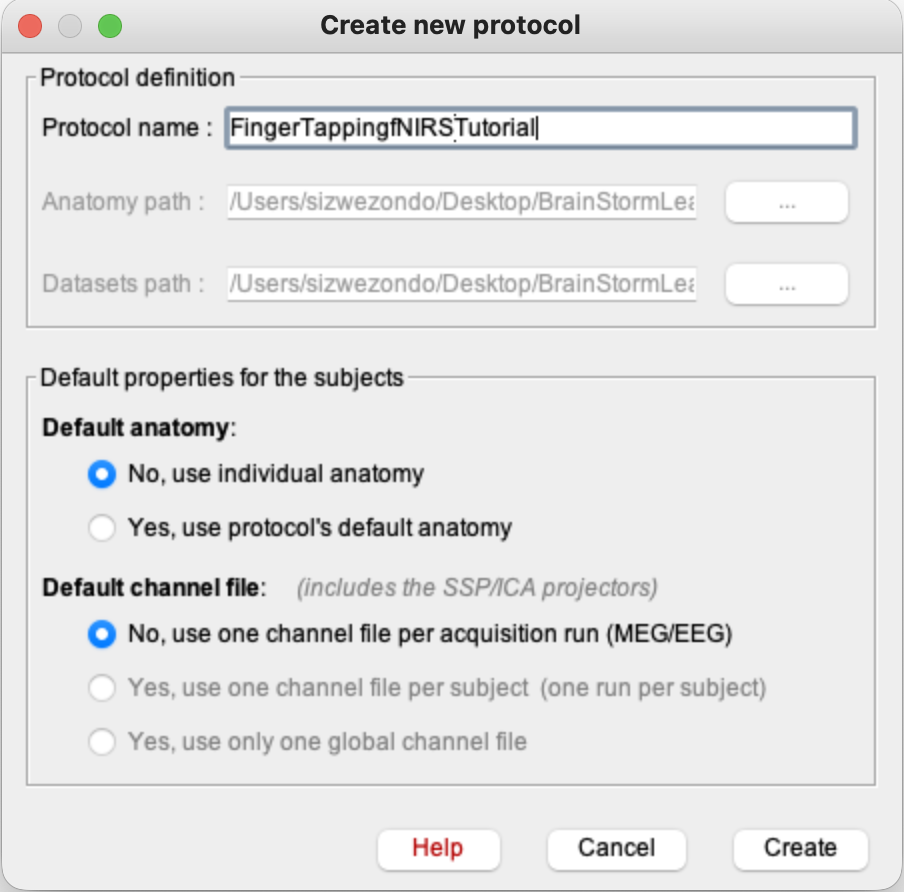
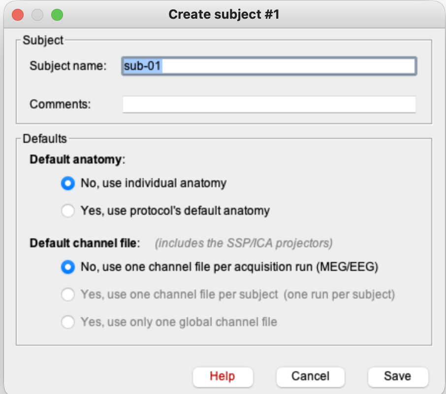
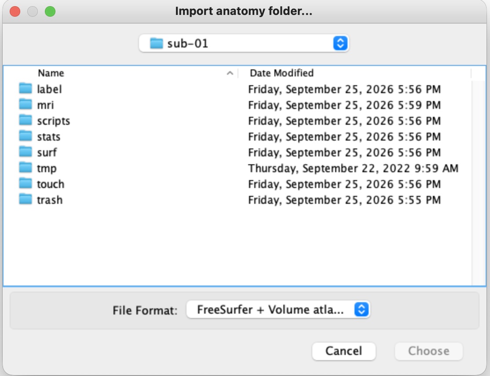
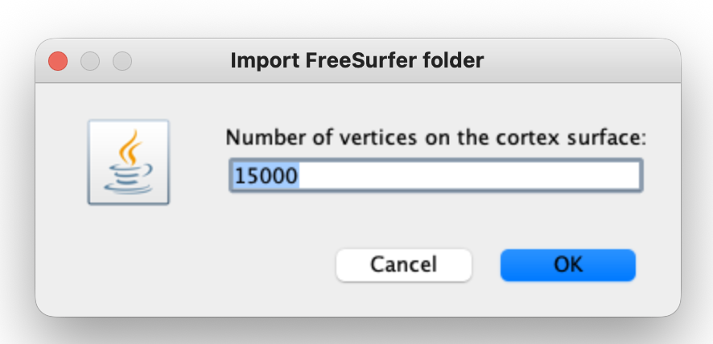
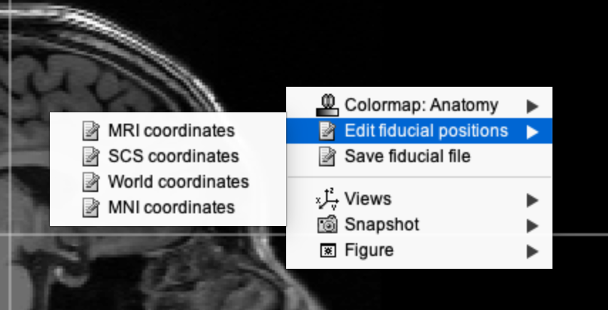
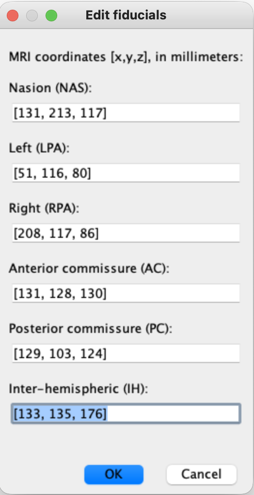
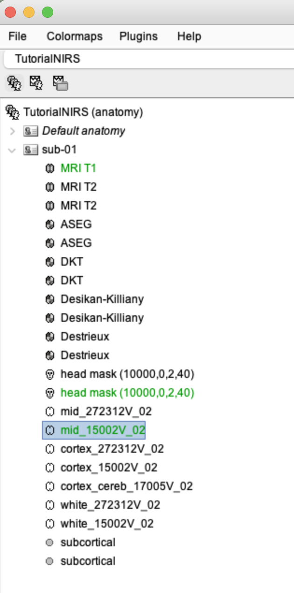
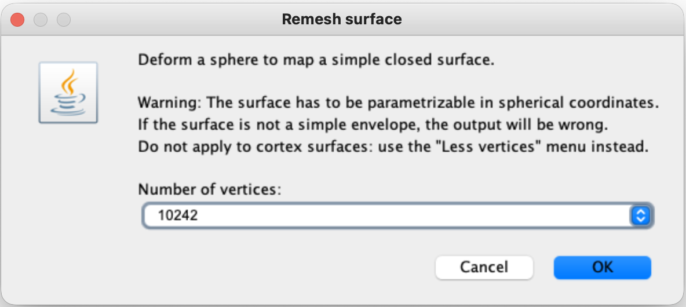
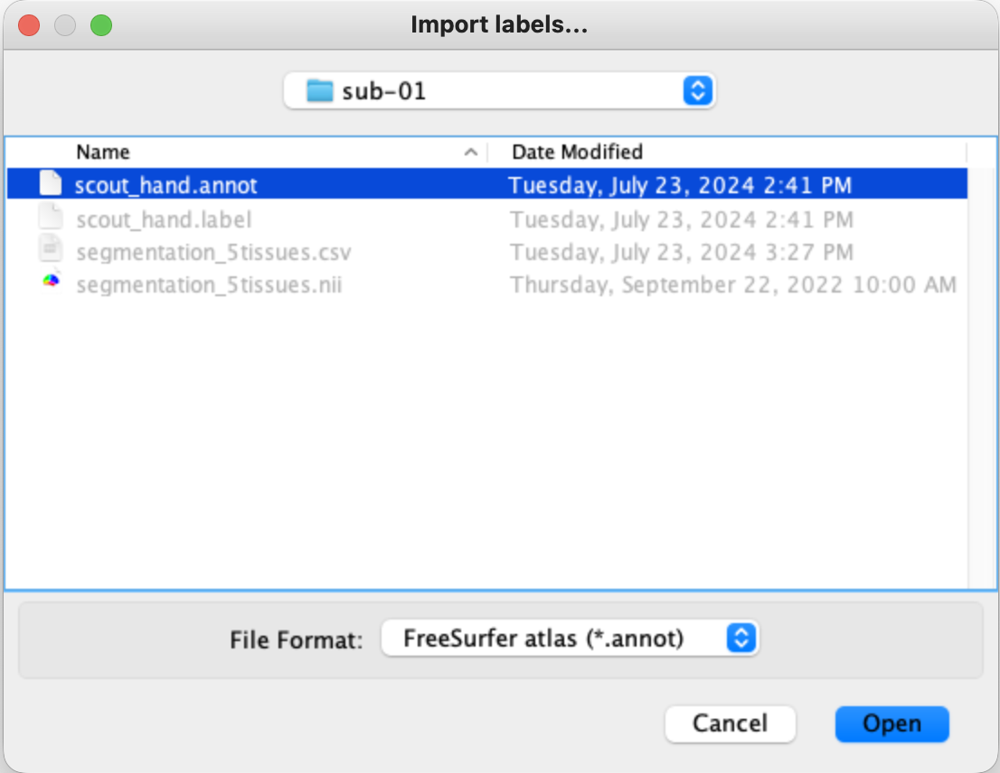

# Lesson 3 — Protocol and anatomy

<strong>Status</strong> Complete

<strong>Product</strong> Participant anatomy and hand scout

<strong>Tutorial choice</strong> Individual anatomy

## Aim

Create the Brainstorm protocol, import the participant's FreeSurfer anatomy, select the surfaces required for optical modelling and add the motor-hand scout.

## 1. Create the protocol

1. In the main Brainstorm window, select **File → New protocol**.
2. Enter a clear name, such as **FingerTappingfNIRSTutorial**.
3. Under **Default anatomy**, select **No, use individual anatomy**.
4. Under **Default channel file**, select **No, use one channel file per acquisition run**.
5. Select **Create**.

*Figure 3.1. The tutorial protocol uses individual anatomy and one channel file per acquisition run.*

These settings are correct for this tutorial because it includes a participant-specific 3T MRI processed with FreeSurfer.

## 2. Create the participant

1. Switch to the **Anatomy** view using the anatomy-tree icon above the database panel.
2. Right-click the protocol name and select **New subject**.
3. Enter **sub-01**.
4. Leave the protocol defaults unchanged and select **Save**.

*Figure 3.2. Create `sub-01` inside the new protocol before importing its anatomy.*

## 3. Import the FreeSurfer anatomy

1. Right-click **sub-01 → Import anatomy folder**.
2. Set **File format** to **FreeSurfer + volume atlases**.
3. Navigate to `nirstorm_tutorial_2024/derivatives/FreeSurfer/sub-01`.
4. Select the **sub-01 folder itself**, which contains folders such as `mri`, `surf` and `label`, then choose it.

*Figure 3.3. Select the FreeSurfer subject folder, not an individual MRI or surface file.*

5. When asked for the number of cortex vertices, retain the default value **15000** and select **OK**.
6. Select **Yes** when Brainstorm asks whether to apply the transformation.

*Figure 3.4. The tutorial retains approximately 15,000 vertices for the low-resolution cortical surfaces.*

## 4. Enter the dataset-specific fiducials

Enter the supplied MRI coordinates in millimetres:

| Fiducial | Coordinates [x, y, z] |
|---|---|
| Nasion (NAS) | [131, 213, 117] |
| Left preauricular point (LPA) | [51, 116, 80] |
| Right preauricular point (RPA) | [208, 117, 86] |
| Anterior commissure (AC) | [131, 128, 130] |
| Posterior commissure (PC) | [129, 103, 124] |
| Inter-hemispheric point (IH) | [133, 135, 176] |

Select **OK**, then save the MRI changes if Brainstorm asks.

*Figure 3.5. If the coordinate dialogue is not already open, use **MRI Viewer → Edit fiducial positions**.*

*Figure 3.6. These values belong to the tutorial participant and must not be reused for a different participant.*

!!! warning "Participant-specific values"
    Fiducial coordinates are not generic settings. For a new participant, use that participant's MRI/digitisation information rather than copying the tutorial values.

## 5. Select the default cortical surface

1. Expand **sub-01** in the Anatomy tree.
2. Locate **mid_15002V**. A duplicate import may add a suffix, such as **mid_15002V_02**.
3. If it is not green, right-click it and select **Set as default cortex**.
4. Confirm that the selected mid-surface appears green.

*Figure 3.7. The imported anatomy includes MRI volumes, atlases, head masks and cortical surfaces.*

## 6. Remesh the head surface

1. Right-click the imported **head mask**.
2. Select **Remesh**.
3. Enter **10242** vertices and select **OK**.
4. Confirm that the new remeshed head mask is selected in green.

*Figure 3.8. The uniform 10,242-vertex head mesh is used in later optical modelling.*

## 7. Add the motor-hand scout

1. Double-click the green **mid_15002V** surface to open it.
2. Select the **Scout** tab in the right-hand panel.
3. Open **Atlas → Add scouts to Atlas**.
4. Navigate to `nirstorm_tutorial_2024/derivatives/segmentation/sub-01/scout_hand.annot`.
5. Confirm the format **FreeSurfer atlas (*.annot)** and select **Open**.
6. Confirm that the red **RC hand** scout appears over the right motor-hand region.

*Figure 3.9. Import `scout_hand.annot` into the atlas attached to the mid-surface.*

*Figure 3.10. The red RC hand scout marks the tutorial's motor-cortex target.*

## Application to studies without participant MRI

!!! important "Your future NIRSport2 workflow"
    For a study without participant MRI, create a separate protocol and select **Yes, use protocol's default anatomy**. Import the nominal NIRSite montage, register it to the template using carefully measured 10–20 landmarks, and report the cortical coverage as a template-based estimate. This is practical for portable fNIRS research but less participant-specific than individual MRI plus digitised optode locations.

## Checkpoint

The Anatomy tree should contain `sub-01`, the MRI and FreeSurfer surfaces, a green remeshed head mask, a green `mid_15002V` surface and the RC hand scout.

## Self-check {.quiz}

**1. What should be selected when a study has no participant MRI?**  
A. The protocol's default anatomical template  
B. No anatomy  
C. The raw time series as anatomy

Reveal answer after attempting
<strong>A.</strong> The template supplies the anatomical model that an individual MRI would otherwise provide.

**2. Which surface is selected as the default cortex in this tutorial?**  
A. The remeshed head mask  
B. The mid-cortical surface  
C. The white-matter surface only

Reveal answer after attempting
<strong>B.</strong> The green mid-surface is used for the later cortical reconstruction.

**3. What should be selected when importing FreeSurfer anatomy?**  
A. One `.surf` file only  
B. The complete participant folder containing `mri`, `surf` and `label`  
C. The SNIRF recording

Reveal answer after attempting
<strong>B.</strong> Brainstorm needs the complete FreeSurfer subject structure.

**4. Why must the tutorial fiducial coordinates not be copied to a new participant?**  
A. They are specific to the tutorial participant's MRI  
B. They control the sampling rate  
C. They are wavelength values

Reveal answer after attempting
<strong>A.</strong> Fiducials describe anatomical locations for a particular participant or template.

**5. What does the imported RC hand scout represent?**  
A. A bad-channel list  
B. The right cortical hand-motor target  
C. The left preauricular point

Reveal answer after attempting
<strong>B.</strong> It marks the expected cortical region for the left-hand tapping response.

