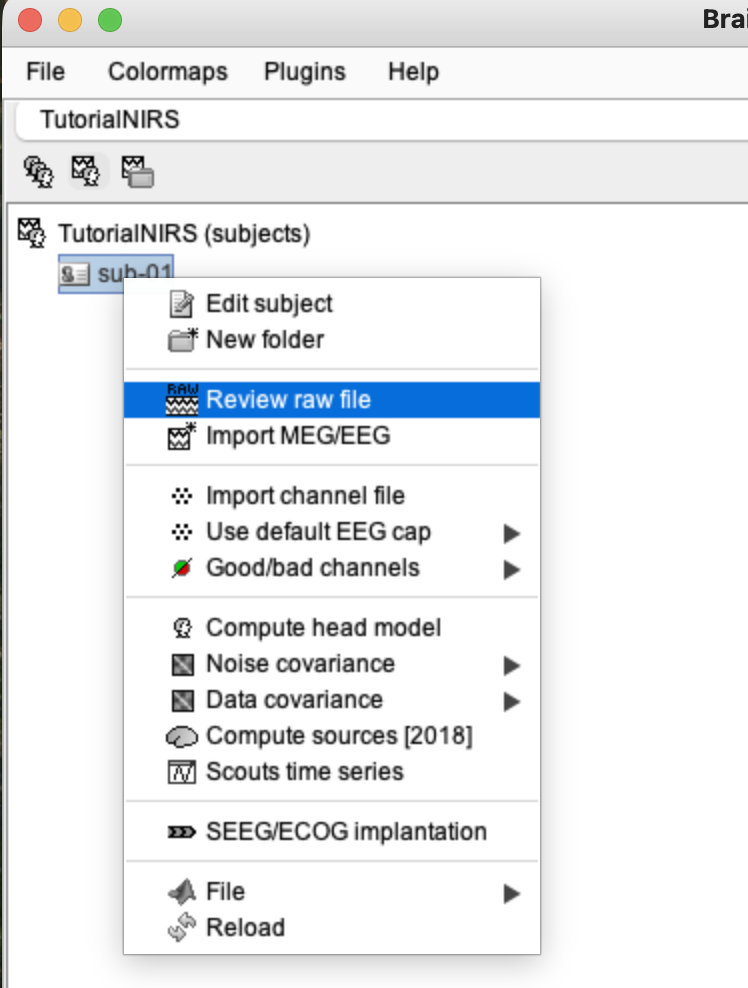
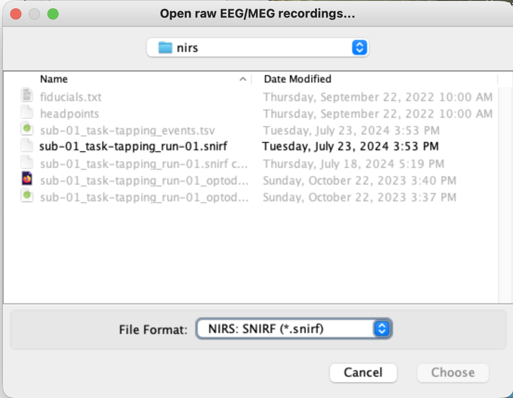
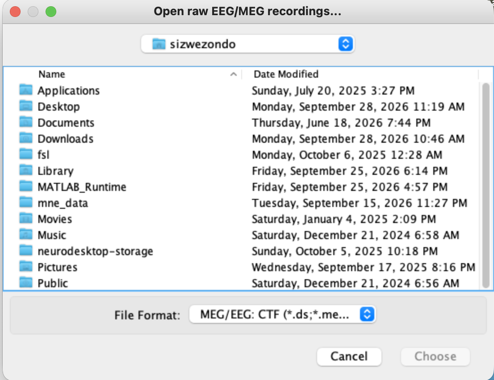
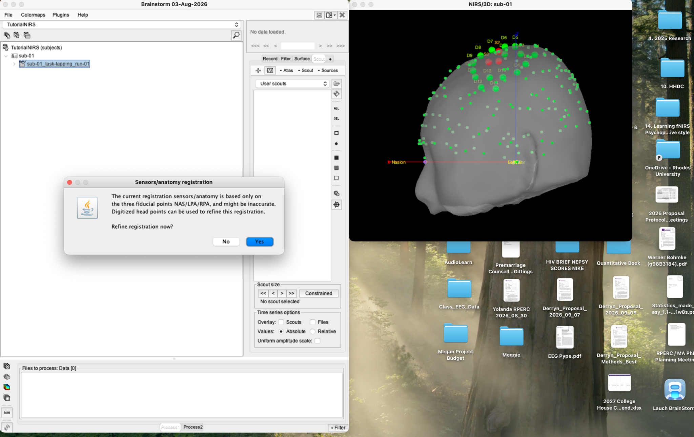
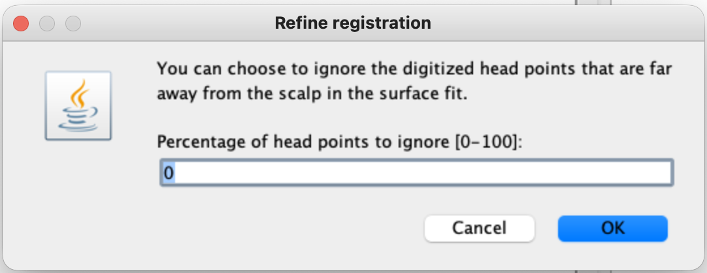
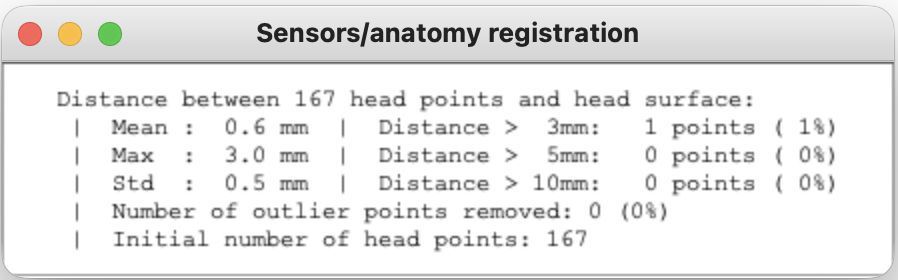
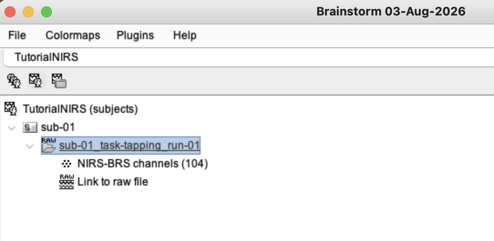
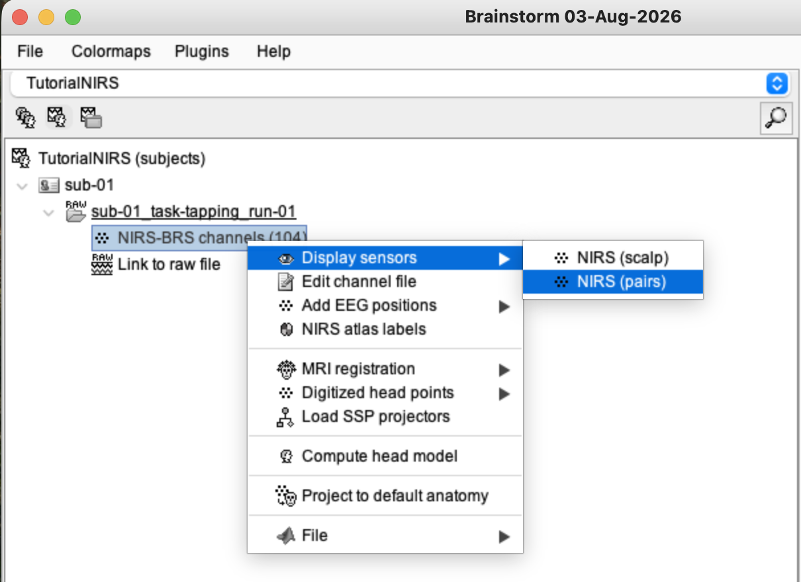
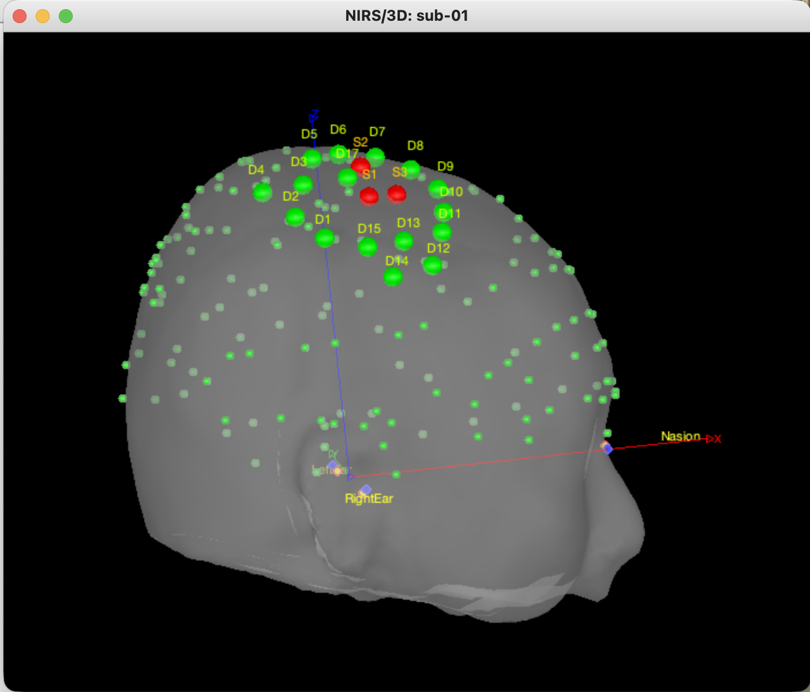

# Lesson 4 — Import the recording and check coregistration

<strong>Status</strong> Complete

<strong>Product</strong> Imported SNIRF recording and checked montage registration

<strong>Focus</strong> Sources, detectors and anatomy

## Aim

Import the finger-tapping SNIRF recording, inspect the source–detector geometry and verify how the digitised montage aligns with the participant's MRI.

## 1. Switch to the functional-data tree

Select the **functional data** icon above the database tree. The protocol label should change from **TutorialNIRS (anatomy)** to **TutorialNIRS (subjects)**.

## 2. Import the SNIRF recording

1. Right-click **sub-01**.
2. Select **Review raw file**.

*Figure 4.1. Begin from the functional-data tree by right-clicking `sub-01` and selecting **Review raw file**.*

3. In the file browser, set **File format** to **NIRS: SNIRF (*.snirf)**.
4. Open **nirstorm_tutorial_2024 → sub-01 → nirs**.
5. Select **sub-01_task-tapping_run-01.snirf**, then select **Choose/Open**.

*Figure 4.2. Import the raw SNIRF file using the NIRS: SNIRF format.*

*Figure 4.3. If the file is not visible, confirm that the browser's format menu is set to **NIRS: SNIRF**.*

Brainstorm reads the wavelength data, events, optode locations, fiducials and available digitised head points from the tutorial files.

## 3. Respond to the registration prompts

The tutorial dataset contains digitised NAS/LPA/RPA landmarks and additional head-shape points. Brainstorm first performs a rigid landmark registration and may then offer to refine it using the extra head points.

1. Accept the proposed MRI registration.

*Figure 4.4. Accept the proposed registration so the imported montage is aligned with the anatomy.*

2. If **Refine registration** appears, retain **0%** head points ignored for this tutorial and select **OK**.

*Figure 4.5. The tutorial refinement retains all digitised head points.*

3. Review the resulting registration report.

The tutorial report returned approximately:

- mean head-point distance: **0.6 mm**;
- maximum distance: **3.0 mm**;
- standard deviation: **0.5 mm**;
- one point above 3 mm and none above 5 or 10 mm.

*Figure 4.6. The small head-point distances support a close fit for this tutorial registration.*

!!! caution "Do not use one universal cut-off"
    Registration error must be interpreted alongside the 3D display, digitisation method and intended spatial precision. A small mean error does not rule out a local optode-placement error or left–right reversal.

## 4. Locate the imported files

Expand **sub-01 → sub-01_task-tapping_run-01**.

The tree should contain a NIRS sensor/channel entry and **Link to raw file**.

*Figure 4.7. The imported recording contains its channel definition and a link to the continuous raw data.*

!!! info "Possible version difference"
    The sensor/channel entry may show a different number in different Brainstorm/NIRSTORM versions—for example **NIRS-BRS channels (104)** in our display and **NIRS-BRS sensors (97)** in the official tutorial. Select the NIRS-BRS sensor/channel entry associated with the run.

## 5. Display the montage

1. Right-click the **NIRS-BRS sensors/channels** entry.
2. Select **Display sensors → NIRS (pairs)**.
3. Confirm that sources are red, detectors are green and source–detector pairings are blue.
4. Close or retain the view, then select **Display sensors → NIRS (scalp)** to inspect optodes against the scalp surface.

*Figure 4.8. Use NIRS (pairs) for the channel geometry and NIRS (scalp) for scalp contact.*

*Figure 4.9. The personalised montage is concentrated over the right motor region.*

## 6. Check the MRI registration

1. Right-click the same NIRS-BRS sensor/channel entry.
2. Select **MRI registration → Check**.
3. Rotate the 3D head and inspect it from several angles.
4. Confirm that:

    - red sources and green detectors lie close to the scalp;
    - NAS, LPA and RPA are in plausible anatomical positions;
    - the additional digitised head points follow the scalp surface;
    - the montage is over the intended right motor region;
    - there is no obvious translation, rotation or left–right reversal.

*Figure 4.10. Large coloured spheres are optodes; the many small points describe the digitised head shape.*

## What coregistration means

Coregistration places the optode geometry and participant anatomy in one coordinate system. The initial fit uses the three landmarks NAS, LPA and RPA; extra head points refine the alignment. It does not alter the fNIRS time series—it determines where the measurement channels are located anatomically.

## Application to your NIRSport2 studies

With careful 10–20 cap placement and a nominal NIRSite montage, template-based registration is practical without buying a Polhemus digitiser. A 3D digitiser such as Polhemus or Brainsight improves participant-specific localisation because it records the actual landmarks and optode positions.

## Checkpoint

The run is visible in the functional tree, the raw link opens, the montage appears over the right motor region, and the registration has been checked from more than one viewpoint.

## Self-check {.quiz}

**1. What does coregistration connect?**  
A. Events to filters  
B. Optodes to anatomy  
C. HbO to HbR

Reveal answer after attempting
<strong>B.</strong> Coregistration places optode geometry in anatomical coordinates.

**2. Which command inspects the existing alignment without redefining it?**  
A. MRI registration → Check  
B. File → Delete  
C. Events → Detect

Reveal answer after attempting
<strong>A.</strong> It opens the registered sensors and anatomy for visual verification.

**3. Which import command is used for the tutorial recording?**  
A. Review raw file  
B. Import MRI  
C. Add scout

Reveal answer after attempting
<strong>A.</strong> The continuous SNIRF recording is linked through **Review raw file**.

**4. What does a small mean head-point distance indicate?**  
A. The head points are generally close to the fitted scalp surface  
B. Every optode is guaranteed to be perfectly placed  
C. Motion artefacts have been removed

Reveal answer after attempting
<strong>A.</strong> It supports a close overall geometric fit but does not replace visual inspection.

**5. Which display best reveals the source–detector channel geometry?**  
A. NIRS (pairs)  
B. MRI coordinates  
C. Event list

Reveal answer after attempting
<strong>A.</strong> **NIRS (pairs)** shows sources, detectors and their channel connections.

