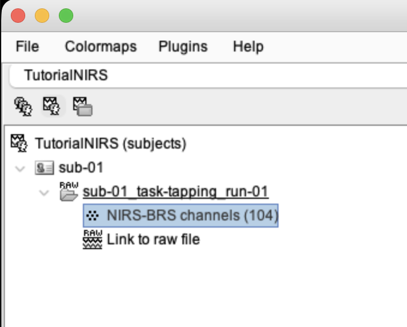
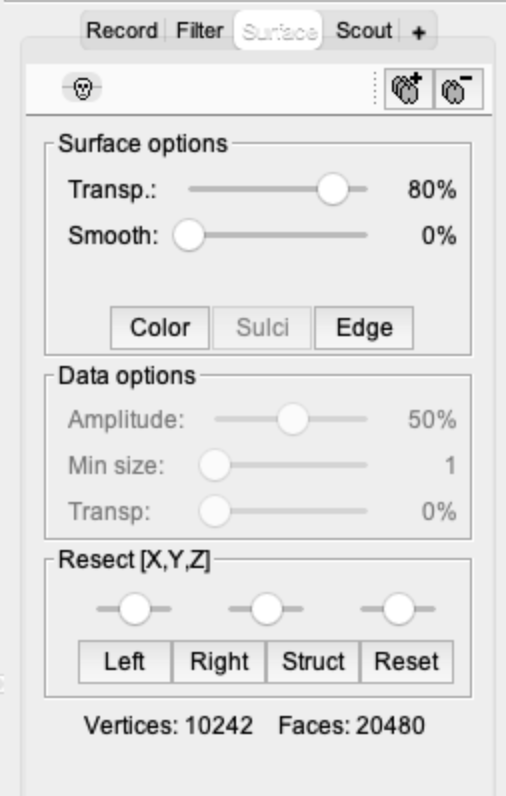
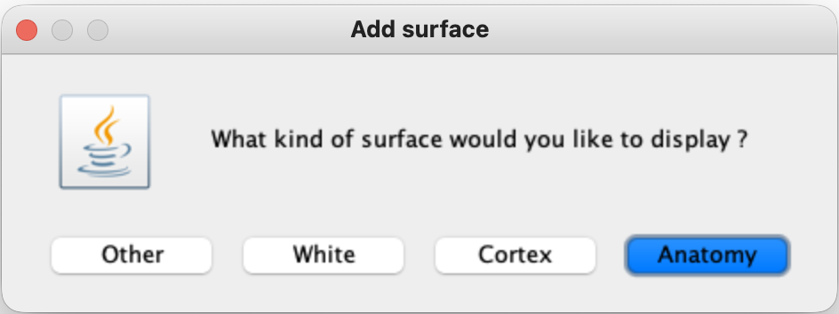
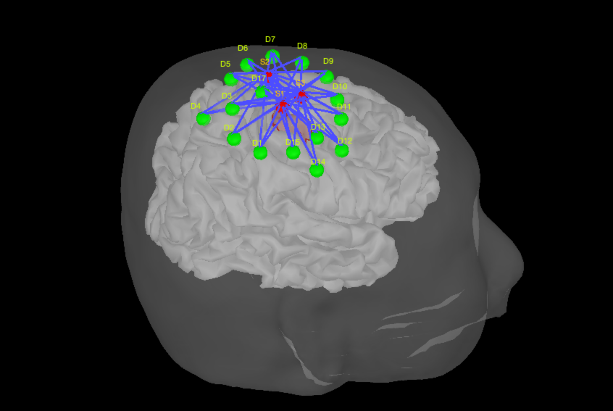
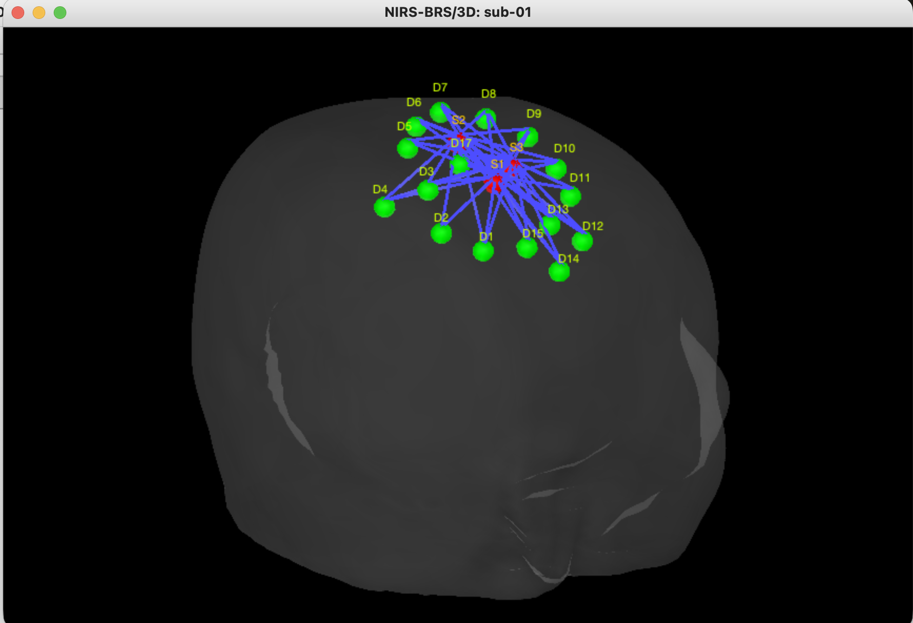
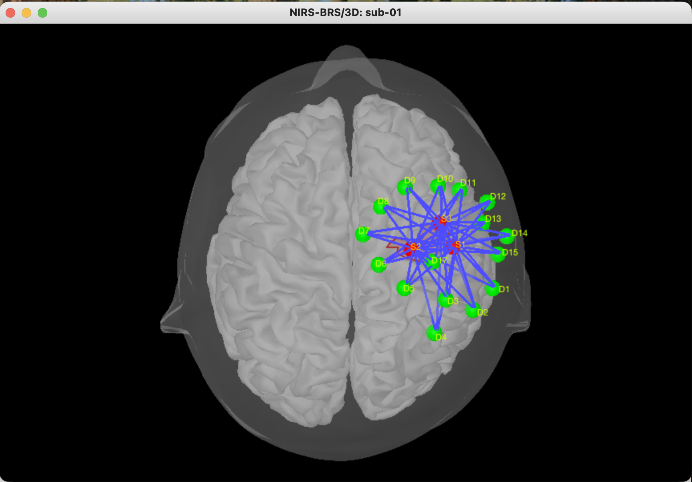

# Lesson 5 — Create publication-style montage views

<strong>Status</strong> Complete

<strong>Product</strong> Right-lateral and superior montage figures

<strong>Focus</strong> Spatial communication

## Aim

Create clear, reproducible figures showing where the fNIRS montage lies relative to the participant's head, cortex and right motor-hand target.

## 1. Open the 3D montage

1. In the **functional-data tree**, expand **sub-01 → sub-01_task-tapping_run-01**.
2. Right-click the **NIRS-BRS sensors/channels** entry.
3. Select **Display sensors → NIRS (pairs)**.

*Figure 5.1. Start from the NIRS-BRS sensor/channel entry associated with the recording.*

*Figure 5.2. First confirm that the optodes and pairings are visible before changing the anatomy display.*

## 2. Locate the Surface tab

The **Surface** tab is in the **right-hand control panel of the main Brainstorm window**, beside Record and Filter. It is not inside the floating 3D montage window.

Use this tab to:

- select the displayed surface;
- change transparency;
- control surface smoothing;
- switch edges or sulci on and off;
- use the predefined Left, Right, Front, Back and Reset view buttons.

*Figure 5.3. The Surface tab controls appearance and predefined viewpoints.*

## 3. Add or reveal the anatomy

If the 3D view shows only the scalp:

1. Select the **+** button beside the Surface tab.
2. Choose **Anatomy** to add an anatomical surface.
3. Select the scalp/head surface in the Surface drop-down.
4. Increase its transparency until the cortex is visible without hiding the optodes.

*Figure 5.4. Add the participant anatomy when the cortex is not visible in the montage window.*

*Figure 5.5. Adjust scalp transparency so both the anatomy and montage remain interpretable.*

*Figure 5.6. Use the RC hand scout as a reference when judging whether the montage covers the intended motor-hand region.*

## 4. Create the right-lateral view

1. Rotate the 3D head until the participant's right side faces the viewer, or use the predefined **Right** view.
2. Centre the head and zoom so the montage fills the window without cropping labels.
3. Check that sources, detectors and channel pairings remain distinguishable.
4. Right-click inside the 3D figure and select **Snapshot → Save as image**. The shortcut **Ctrl/Cmd + I** may also be used.
5. Save with a descriptive name such as **montage_right_lateral.png**.

*Figure 5.7. Right-lateral view showing the montage over the right motor region.*

## 5. Create the superior view

1. Rotate the head to a top-down view or use the predefined **Top/Superior** view.
2. Confirm that the left–right orientation is clear.
3. Save a second snapshot as **montage_superior.png**.

*Figure 5.8. Superior view showing the spatial arrangement of sources, detectors and pairings.*

## What students should check

- source and detector labels are readable;
- the montage is concentrated over the intended right motor region;
- the cortical surface remains visible but does not obscure the optodes;
- the head orientation can be understood without guessing;
- the image is not a desktop screenshot containing unrelated windows;
- the filename and eventual caption identify the viewpoint.

## Suggested figure caption

“Registered fNIRS montage displayed on the participant anatomy. Sources are shown in red, detectors in green and source–detector pairings in blue. Right-lateral and superior views illustrate coverage of the right motor-hand region.”

## Checkpoint

You should now have two clean images—a right-lateral view and a superior view—with readable optode labels, visible anatomical context and an unambiguous head orientation.

## Self-check {.quiz}

**1. Why save more than one montage view?**  
A. To increase the sampling rate  
B. To communicate spatial coverage that one projection may hide  
C. To correct motion

Reveal answer after attempting
<strong>B.</strong> Lateral and superior projections reveal complementary aspects of montage coverage.

**2. Where is the Surface tab?**  
A. In the right-hand panel of the main Brainstorm window  
B. Inside the SNIRF file  
C. In the event list

Reveal answer after attempting
<strong>A.</strong> It controls the surfaces displayed in the active Brainstorm 3D figure.

**3. What is the purpose of adjusting scalp or cortex transparency?**  
A. To see the anatomy and optodes together  
B. To change the wavelength  
C. To delete hidden channels

Reveal answer after attempting
<strong>A.</strong> Transparency helps preserve anatomical context without obscuring the montage.

**4. Which view is especially useful for showing left–right and anterior–posterior montage arrangement?**  
A. Superior view  
B. Event list  
C. Pipeline editor

Reveal answer after attempting
<strong>A.</strong> A top-down superior view makes the montage's spatial distribution easier to interpret.

**5. What should a publication-style montage image avoid?**  
A. Readable optode labels  
B. Unrelated desktop windows and ambiguous orientation  
C. More than one anatomical viewpoint

Reveal answer after attempting
<strong>B.</strong> The saved image should focus on the montage and make its orientation clear.

