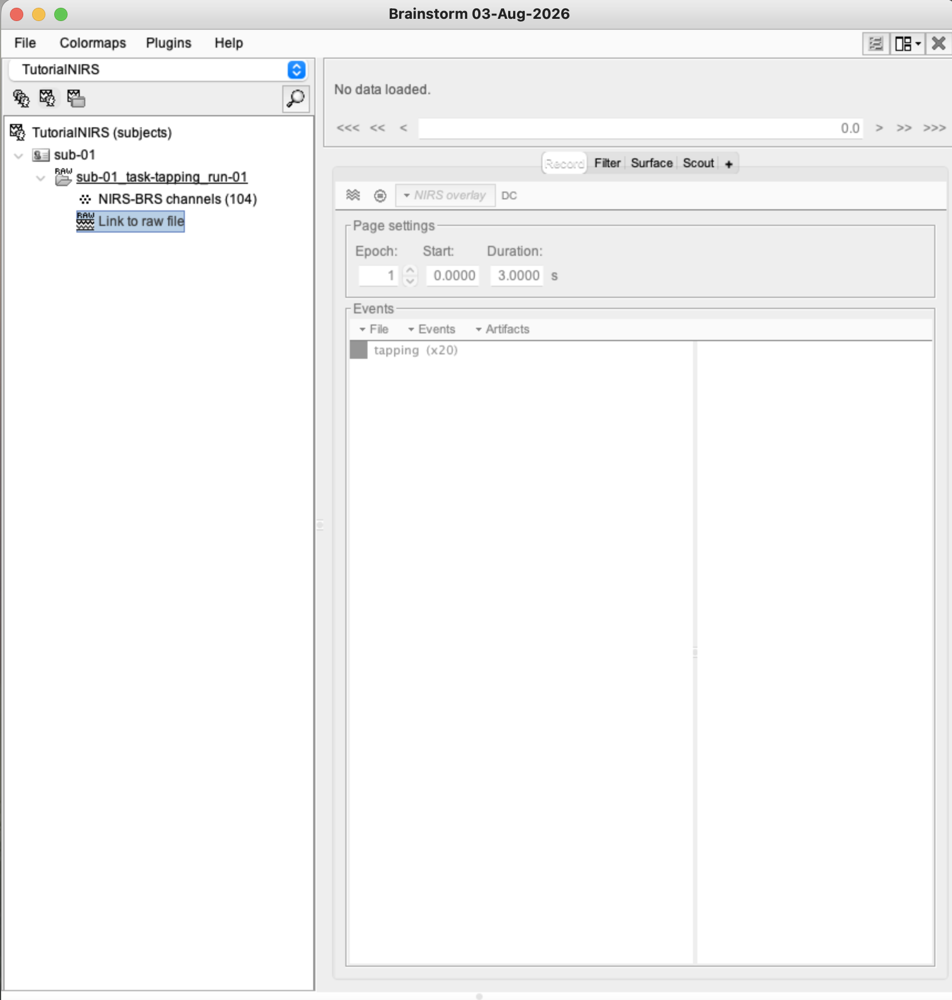
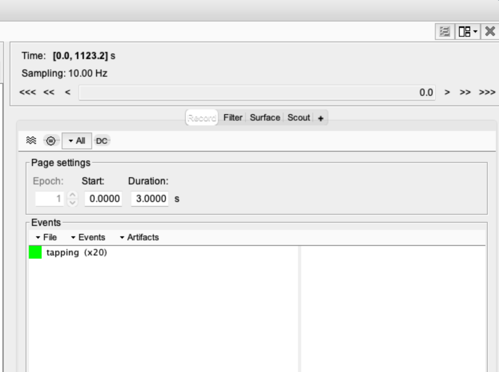
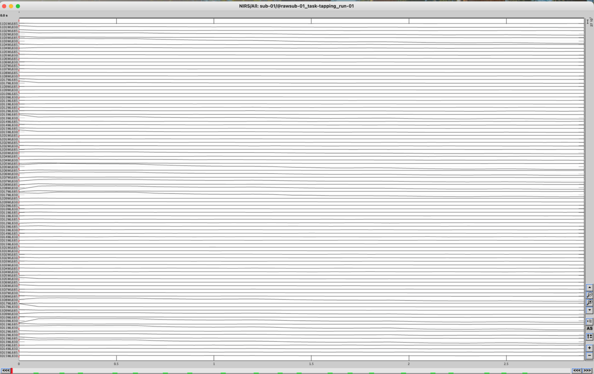
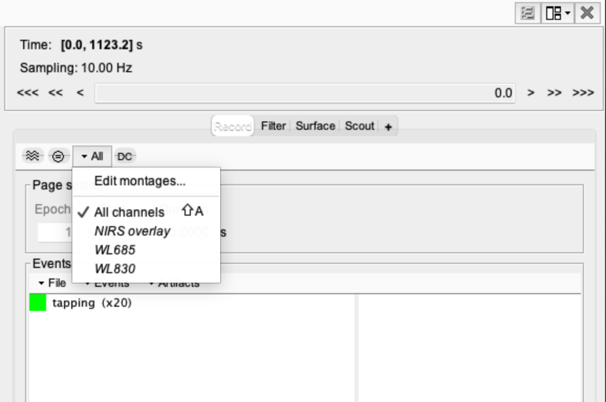
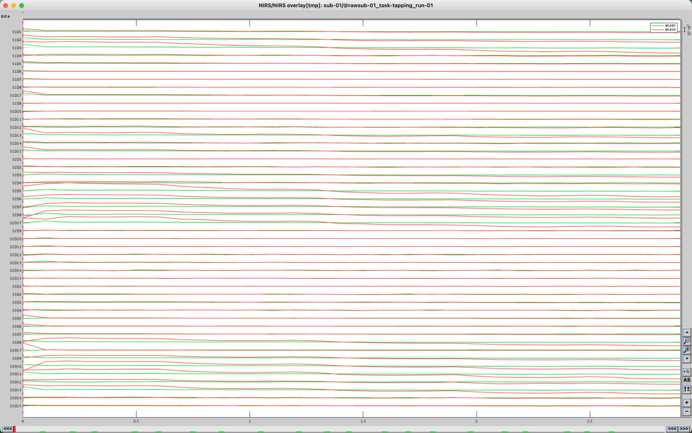
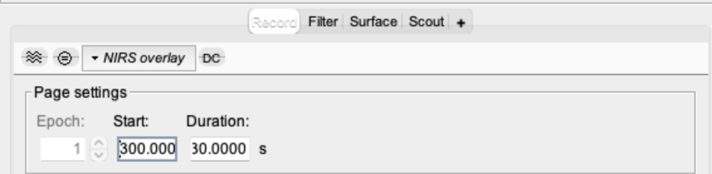
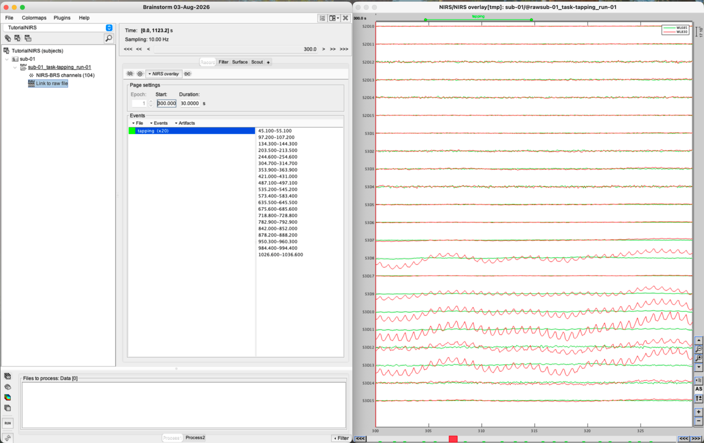
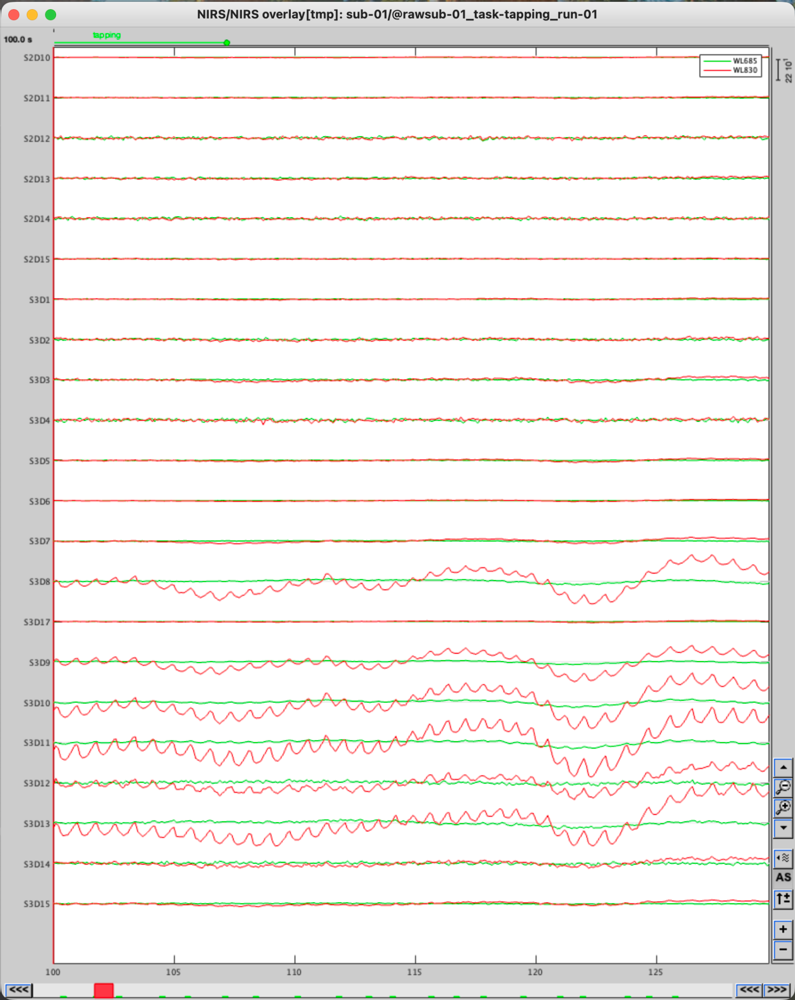
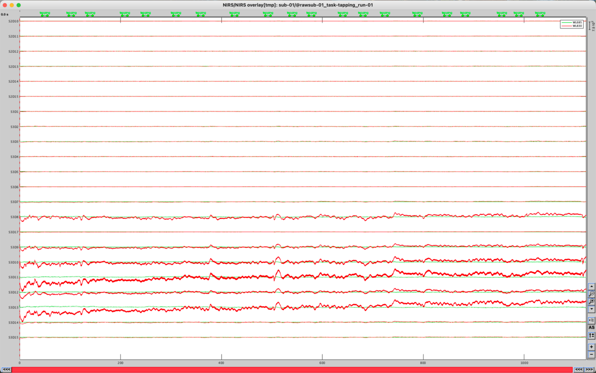

# Lesson 6 — Explore the raw recording

<strong>Status</strong> Complete

<strong>Product</strong> Documented raw-signal observations

<strong>Brainstorm tab</strong> Record

## Aim

Open the continuous fNIRS recording, inspect both wavelengths at several time scales and document possible physiological rhythms, drift, motion and poor-quality channels before preprocessing.

!!! note "What the traces represent"
    These are the original light-intensity measurements at 685 and 830 nm. They are not yet optical density, HbO, HbR or HbT.

## 1. Open the raw time series

1. Work in the **functional-data tree**.
2. Expand **sub-01 → sub-01_task-tapping_run-01**.
3. Double-click **Link to raw file**.
4. If Brainstorm offers a display type, select **NIRS → Display time series**.
5. Confirm that the time-series window opens and that labels use source–detector names such as S2D10.

*Figure 6.1. Double-click Link to raw file under the imported run.*

## 2. Locate the Record tab

The **Record** tab is in the **right-hand control panel of the main Brainstorm window**. It contains the display time, Page settings and Events list.

*Figure 6.2. Start and Duration control the visible time interval.*

## 3. Use the NIRS Overlay montage

If the two wavelengths are not colour-coded together:

*Figure 6.3. Before overlay selection, the wavelength traces may be densely stacked and difficult to compare.*

1. Right-click inside the time-series figure.
2. Select **Montage → NIRS Overlay**.
3. Use the montage drop-down in the Record panel to show:

    - **All channels**;
    - **NIRS overlay**;
    - **WL685** only;
    - **WL830** only.

In the overlay used here, 685 nm appears green and 830 nm red. Selecting one trace also identifies the matching wavelength trace for the same source–detector pair.

*Figure 6.4. The montage menu can display both wavelengths or isolate one wavelength.*

*Figure 6.5. The overlay view uses colour to separate the two wavelength traces for each channel.*

## 4. Inspect the complete recording

1. Set **Start = 0**.
2. Set **Duration = 1123.2 s**, or use the full-recording navigation control.
3. Scan from beginning to end before zooming into any one feature.
4. Note broad baseline changes, abrupt discontinuities and channels that remain nearly flat.

*Figure 6.6. The full-run view reveals broad drift and candidate artefact periods.*

## 5. Inspect shorter time windows

**Start** is the first second displayed. **Duration** is the width of the display, not the final time point.

| Desired interval | Start | Duration |
|---|---:|---:|
| 0–30 s | 0 | 30 s |
| 300–330 s | 300 | 30 s |
| 300–570 s | 300 | 270 s |

*Figure 6.7. These settings display 300–330 s, not 300–570 s.*

*Figure 6.8. Selecting a smaller channel group and shorter interval makes local waveform features easier to inspect.*

*Figure 6.9. A short window makes rhythmic fluctuations and abrupt changes easier to recognise.*

*Figure 6.10. Compare more than one interval before deciding that a pattern is persistent.*

## 6. Record what you observe

| Pattern | What it may look like | Interpretation at this stage |
|---|---|---|
| Cardiac pulsation | Regular, rapid oscillation | Evidence that physiological pulsation reaches the detector; used later in coupling metrics. |
| Slow drift | Gradual movement of the baseline | May reflect instrumental, physiological or contact changes. |
| Motion artefact | Sudden step, spike or coordinated disturbance across channels | Candidate motion period requiring closer inspection or correction. |
| Flat channel | Little or no variation | Possible weak or absent signal. |
| Saturation/flooring | Signal constrained near an instrumental limit | Possible detector overload or insufficient received light. |
| Tapping/rest structure | Event markers distributed across the run | Confirms that task timing is available for later epoching. |

!!! warning "Observe before rejecting"
    Do not mark a channel bad merely because it looks unusual in one display window. Lesson 8 applies explicit quality criteria across the recording.

## Suggested observation record

For each notable feature, write down the **channel**, **approximate time**, **appearance** and **provisional interpretation**. Example: “S2D10, approximately 300–330 s: abrupt shared step; possible movement artefact.”

## Key teaching point

The full-run view finds candidate problems; the short-window view reveals their waveform detail. Visual inspection guides—but does not replace—objective quality control.

## Checkpoint

Confirm that you can reopen the full 1123.2-second recording, display a specified short interval using **Start** and **Duration**, compare both wavelengths and record at least one observation without prematurely rejecting a channel.

## Self-check {.quiz}

**1. What does Duration control?**  
A. The width of the displayed time window  
B. The number of detectors  
C. MRI resolution

Reveal answer after attempting
<strong>A.</strong> Start 300 and Duration 30 displays 300–330 seconds.

**2. Why inspect the whole recording before zooming in?**  
A. To locate broad drift and candidate artefact periods  
B. To perform haemoglobin conversion  
C. To create participant anatomy

Reveal answer after attempting
<strong>A.</strong> The complete view guides targeted close-up inspection.

**3. What does an abrupt step shared across several channels suggest?**  
A. A possible motion artefact  
B. A new MRI surface  
C. A wavelength label

Reveal answer after attempting
<strong>A.</strong> Sudden coordinated changes are common visual signatures of movement.

**4. Why use NIRS Overlay?**  
A. To organise the two wavelength traces by source–detector pair  
B. To calculate the haemoglobin concentration immediately  
C. To create participant anatomy

Reveal answer after attempting
<strong>A.</strong> The montage makes the raw wavelength data easier to compare channel by channel.

**5. Why should an unusual-looking channel not be rejected from one short view alone?**  
A. Quality decisions should consider the wider recording and explicit criteria  
B. Brainstorm cannot reject channels  
C. Every unusual waveform is a task response

Reveal answer after attempting
<strong>A.</strong> Visual inspection guides later quality control but does not replace objective checks.

