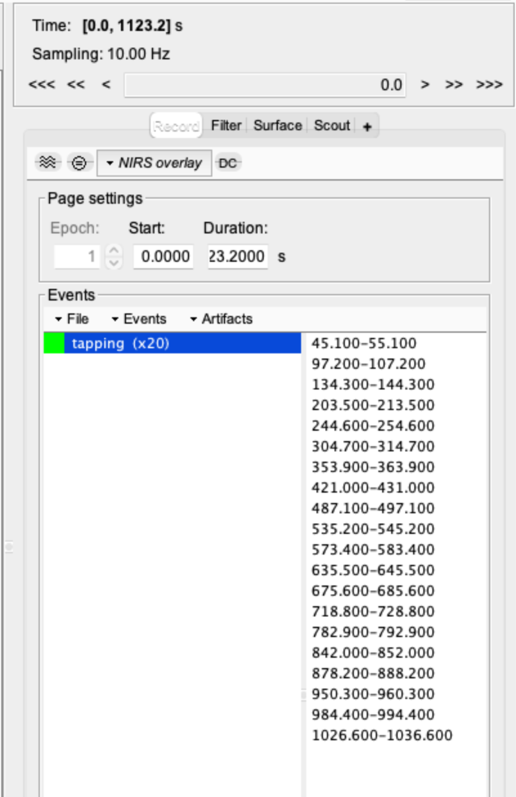
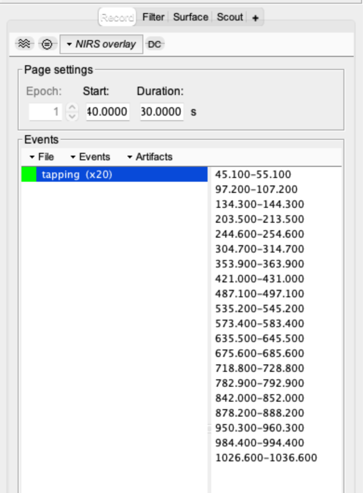
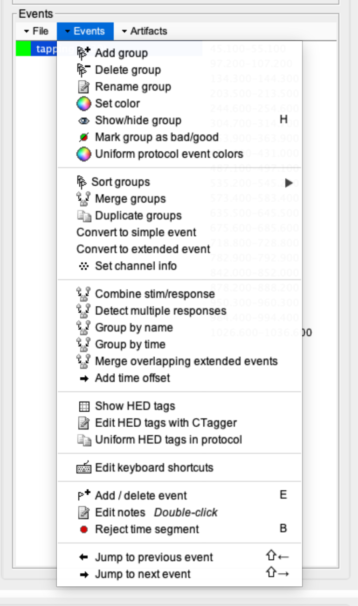
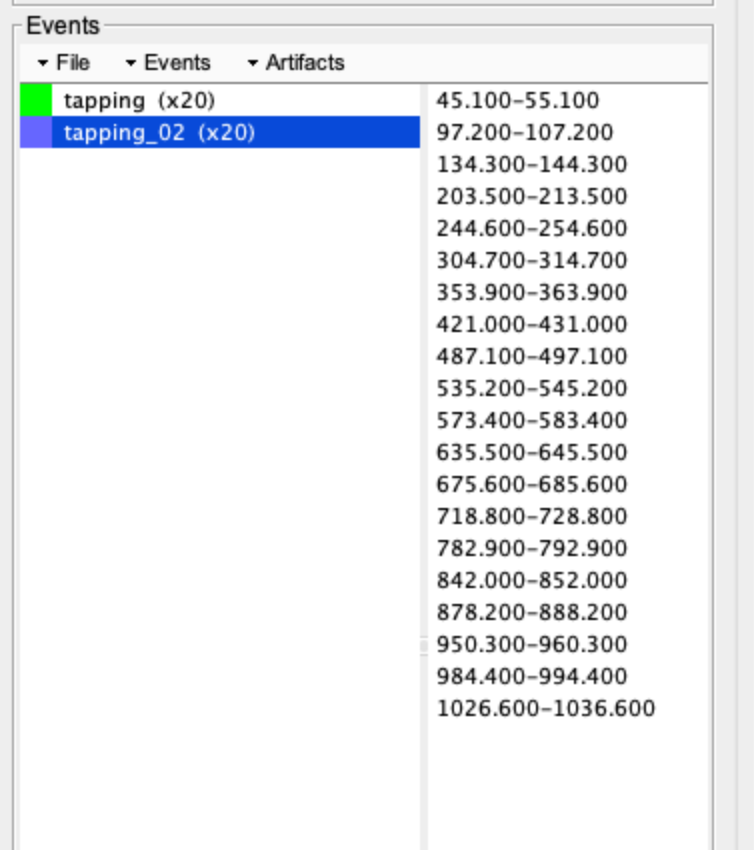
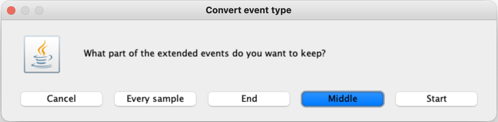
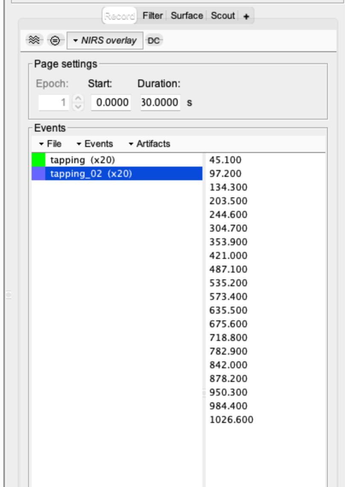
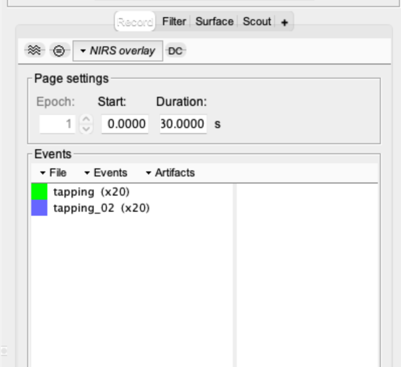
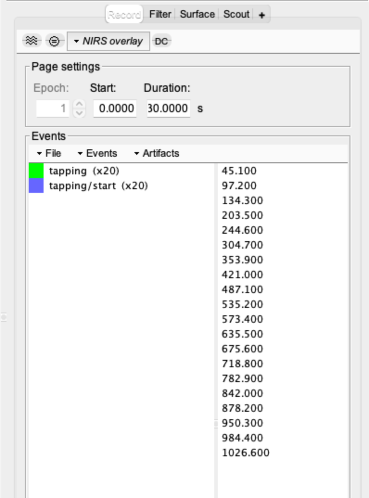
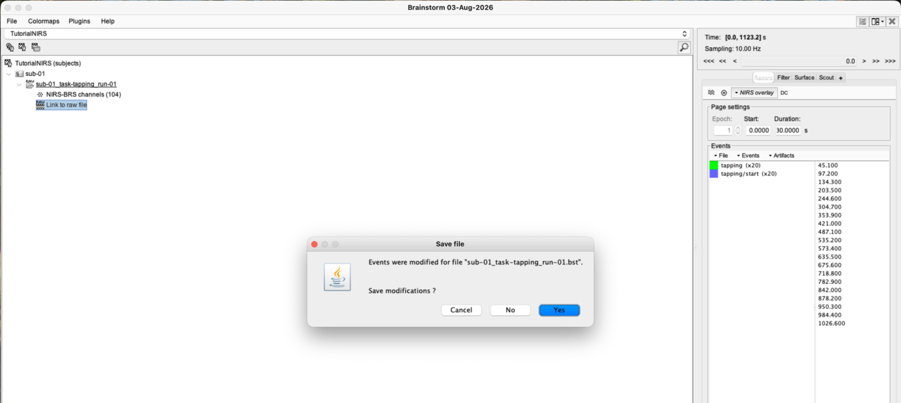

# Lesson 7 — Events and experimental timing

<strong>Status</strong> Complete

<strong>Product</strong> <code>tapping/start</code> onset markers

<strong>Blocks</strong> 20

## Aim

Inspect the recorded finger-tapping blocks and create a second event group containing one marker at the start of each block. These onset markers will later anchor comparable epochs without deleting the original block-duration information.

!!! note "Starting point"
    Begin with **Link to raw file** open in the time-series viewer and the **Record** tab selected in the right-hand control panel.

## 1. Inspect the original tapping events

1. In the **Events** area, select the original **tapping (×20)** group.
2. Inspect the green event bars above the recording. Confirm that there are **20** tapping blocks distributed across the run.
3. Inspect the event list on the right. Each entry should be a time range—for example, **45.100–55.100 s**—showing that each tapping block lasts **10 seconds**.

*Figure 7.1. The original extended tapping events displayed over the complete recording.*

*Figure 7.2. Each original tapping event contains a start and end time.*

*Figure 7.3. Expanding the group lets students verify the onset and offset of every tapping block.*

!!! check "Checkpoint"
    Before editing anything, confirm that the group is labelled **tapping (×20)** and that its entries are ranges rather than single time points.

## 2. Duplicate the event group

1. Select **tapping (×20)** in the Events list.
2. Open the **Events** drop-down menu directly above the list.
3. Select **Duplicate groups**.
4. Confirm that Brainstorm creates a second group, initially named something similar to **tapping_02 (×20)**.

*Figure 7.4. The required commands are located in the Events drop-down menu.*

*Figure 7.5. The duplicate appears as a second 20-event group before conversion.*

!!! warning "Preserve the original group"
    Do not convert or delete the original **tapping** group. It retains the 10-second block durations and may be needed for block-design modelling. Perform the remaining steps on the duplicate only.

## 3. Convert the duplicate to onset markers

1. Select the duplicated group—usually **tapping_02 (×20)**.
2. Open **Events** and select **Convert to simple event**.
3. When Brainstorm asks which part of each extended event to retain, select **Start**. Do not select **Middle**, **End** or **Every sample**.
4. Confirm that the duplicate now contains single times, such as **45.100**, **97.200** and **134.300 s**, rather than time ranges.

*Figure 7.6. Select **Start** to retain the onset of every tapping block.*

*Figure 7.7. The original group retains intervals, while the duplicate contains single onset times.*

*Figure 7.8. Compare the two groups: the original shows time ranges, while the new group shows single onset times.*

## 4. Rename and save the new group

1. Keep the duplicated simple-event group selected.
2. Open **Events → Rename group**.
3. Rename it **tapping/start**.
4. Verify that both groups contain 20 events:

    - **tapping (×20):** extended 10-second blocks;
    - **tapping/start (×20):** simple onset markers.

5. Save the event changes. If Brainstorm displays the **Save modifications?** prompt when you close the time-series window, select **Yes**.

*Figure 7.9. The final event structure contains both the original blocks and the new onset markers.*

*Figure 7.10. Select **Yes** so the event modifications are written to the recording.*

## Extended versus simple events

- An **extended event** contains onset and duration.
- A **simple event** marks one time point.
- `tapping/start` supplies a consistent time zero for epoching and averaging.
- The original `tapping` group preserves the task duration for analyses that model the complete stimulation block.

## GLM connection

A general linear model represents expected task-related haemodynamics using predictors. At its core it is a regression model, although fNIRS GLMs also account for the shape and timing of the haemodynamic response and nuisance effects. For a block design, retaining the original event durations allows the predictor to represent the full tapping period; the new simple events serve as precise epoch anchors.

## Checkpoint

Reopen the recording and verify that **tapping (×20)** still contains extended 10-second intervals and **tapping/start (×20)** contains one simple marker at each block onset. If either count differs, correct the event groups before proceeding.

## Self-check {.quiz}

**1. Why create `tapping/start`?**  
A. To obtain simple epoch anchors  
B. To delete task duration  
C. To increase light intensity

Reveal answer after attempting
<strong>A.</strong> Each epoch needs a consistent task-onset reference.

**2. An extended event contains:**  
A. Only a label  
B. Onset and duration  
C. Only a wavelength

Reveal answer after attempting
<strong>B.</strong> It represents a time interval rather than one instant.

**3. Why duplicate the tapping group before converting it?**  
A. To preserve the original block durations  
B. To double the sampling rate  
C. To remove the participant anatomy

Reveal answer after attempting
<strong>A.</strong> The original extended events remain available for GLM or duration-based analyses.

**4. Which conversion option creates one marker at each block onset?**  
A. Middle  
B. Start  
C. End

Reveal answer after attempting
<strong>B.</strong> **Start** retains the onset of each extended tapping block.

**5. What should you select when Brainstorm asks whether to save the modified events?**  
A. Yes  
B. No  
C. Cancel and delete the run

Reveal answer after attempting
<strong>A.</strong> Saving writes the new `tapping/start` group to the recording.

