# Lesson 8 — Data quality and bad channels

<strong>Status</strong> Complete

<strong>Product</strong> Four documented channel exclusions

<strong>Stage</strong> Start of preprocessing

## Aim

Apply explicit quality criteria to the original light-intensity recording, recognise an over-strict result, reset the channel flags safely and retain a defensible final list of bad source–detector pairs before optical-density conversion.

## Where this lesson fits

Lessons 1–7 organised the dataset, anatomy, montage, raw recording and events. Lesson 8 begins **preprocessing**. Channel quality is assessed before converting intensity to optical density because unreliable light measurements cannot produce trustworthy HbO and HbR estimates.

!!! note "Input file for this lesson"
    Use the original **Link to raw file** under `sub-01_task-tapping_run-01`. The event edits from Lesson 7 are stored with this recording, so there is not a separate “tapping/start file” to choose.

## 1. Place the raw recording in Files to process

1. Work in the **functional-data tree**.
2. Expand **sub-01 → sub-01_task-tapping_run-01**.
3. Select **Link to raw file**.
4. Drag it into the lower **Files to process** panel, or use Brainstorm's process shortcut.
5. Confirm that the panel reads **Files to process: Data [1]** and contains one raw-file link.

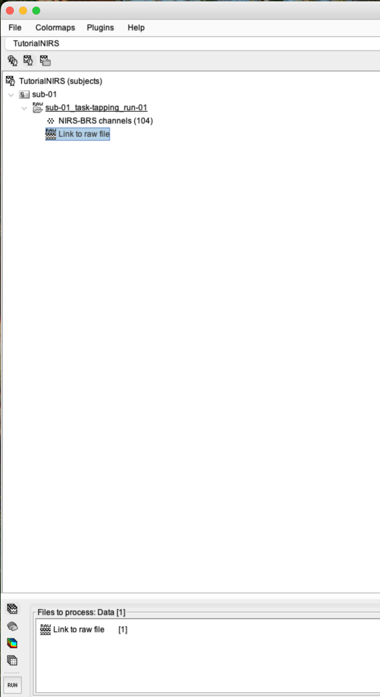
*Figure 8.1. The raw intensity recording—not an optical-density or haemoglobin output—is the input to bad-channel detection.*

## 2. Open the Pipeline editor

1. Select the **RUN** button at the lower left of the process panel.
2. The **Pipeline editor** opens with an empty Process selection area.
3. Select the small **gear and drop-down arrow** at the upper left of the editor to choose a process.

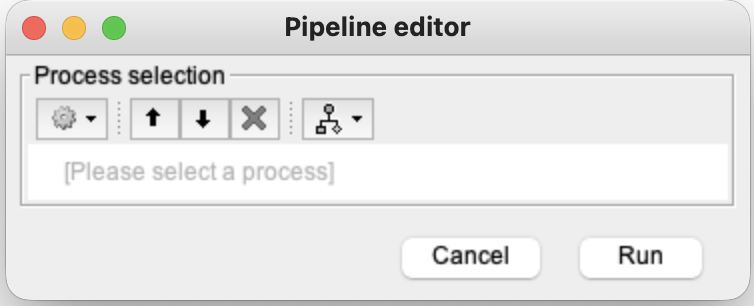
*Figure 8.2. Processes are added from the gear menu; the final Run button executes the selected process.*

## 3. Locate the NIRSTORM quality processes

Follow this menu path:

**NIRS → Pre-process**

Two similarly named processes appear:

- **Signal Quality Control** calculates and exports quality indicators or figures.
- **Detect bad channels** applies selected thresholds and marks measurements as bad for subsequent processing.

For this lesson, choose **Detect bad channels**. Signal Quality Control can be run separately when you want diagnostic measures without changing the channel-status flags.

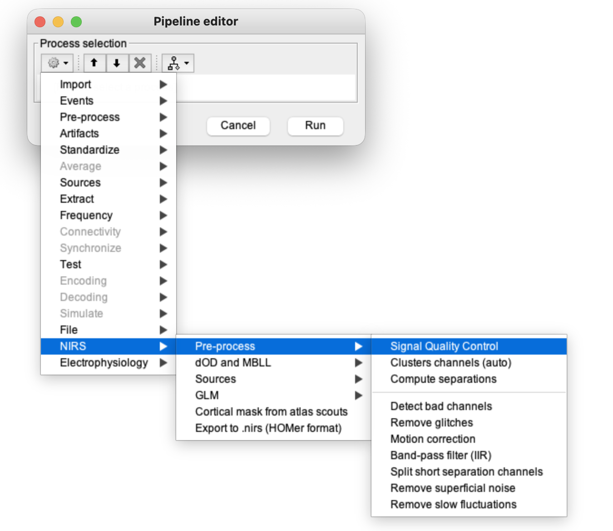
*Figure 8.3. Signal Quality Control and Detect bad channels serve related but different purposes.*

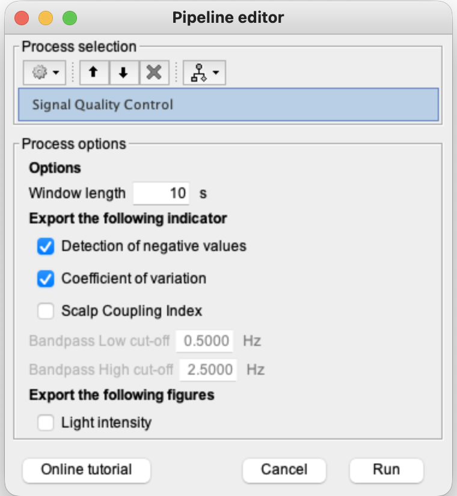
*Figure 8.4. This diagnostic process can export negative-value, coefficient-of-variation and scalp-coupling indicators.*

## 4. Understand the quality criteria

The **Detect bad channels** window groups its criteria into data-based, montage-based and auxiliary-measurement options.

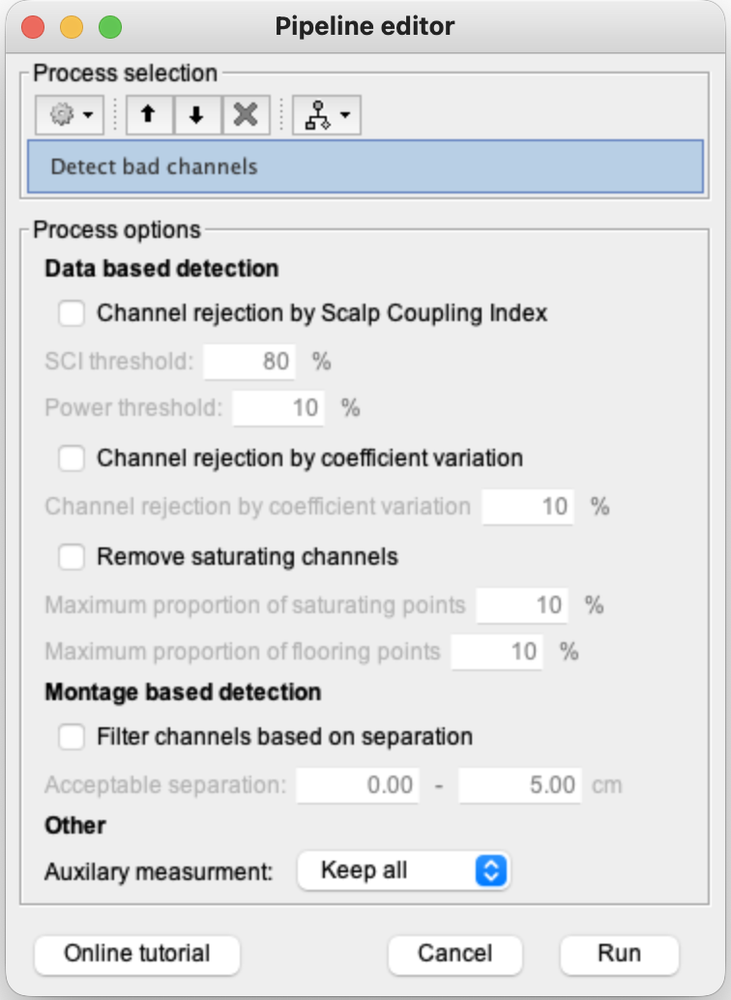
*Figure 8.5. A criterion is inactive until its checkbox is selected.*

| Criterion | What it examines | Why failure matters |
|---|---|---|
| **Scalp Coupling Index (SCI)** | Similarity of the two wavelength signals within a cardiac-frequency band | Low similarity may indicate weak optode–scalp coupling, but the threshold and cardiac power requirements must suit the device and data. |
| **Coefficient of variation (CV)** | Signal variability relative to its mean intensity | Excessive relative variability suggests unstable coupling or noisy intensity measurements. |
| **Saturation** | Proportion of samples at the detector's upper measurable limit | Once saturated, increases in received light cannot be represented accurately. |
| **Flooring** | Proportion of samples near the detector's lower useful limit | Too little detected light produces an unstable, low-information signal. |
| **Source–detector separation** | Whether the channel distance falls inside an accepted physical range | Implausible or unwanted separations can be excluded before physiological analysis. |

!!! important "A pair requires both wavelengths"
    HbO and HbR separation depends on both wavelengths. If either wavelength in a source–detector pair is unusable, the pair should not be treated as a reliable haemoglobin measurement.

## 5. Recognise the over-strict trial

Our initial trial enabled all the available rejection criteria simultaneously:

- SCI threshold: **80%**;
- cardiac-power threshold: **10%**;
- coefficient of variation: **10%**;
- maximum saturating samples: **10%**;
- maximum flooring samples: **10%**;
- acceptable separation: **0–5 cm**;
- auxiliary measurements: **Remove all**.

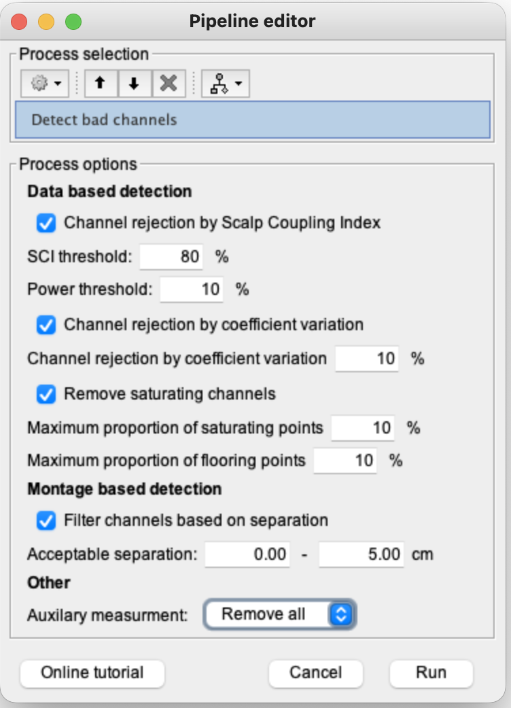
*Figure 8.6. Enabling several strict criteria at once made it difficult to identify which rule drove rejection.*

The resulting report stated that **43 channels—approximately 90%—were removed**. This is a warning sign for a tutorial recording that otherwise displayed widespread usable signals. It does not automatically mean that 90% of the recording is genuinely unusable.

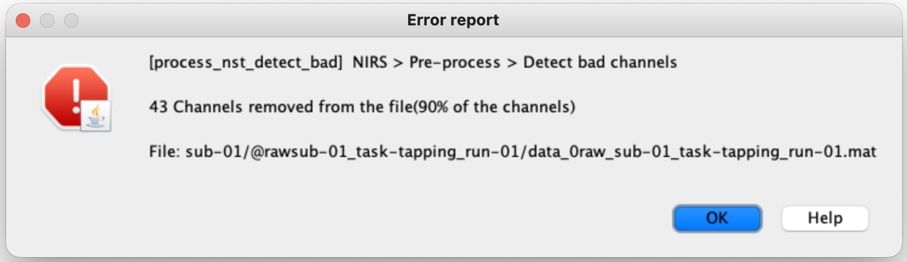
*Figure 8.7. An unexpectedly extreme rejection rate should trigger a review of the thresholds rather than automatic acceptance.*

## 6. Reset the channel flags before rerunning

The first trial changed the good/bad status stored in Brainstorm. Reset those flags before testing revised criteria:

1. Return to the main Brainstorm window.
2. Right-click **Link to raw file**.
3. Select **Good/bad channels → Mark all channels as good**.
4. Read the warning carefully.
5. Select **Yes** only because we deliberately intend to clear the trial flags and rerun the quality procedure.

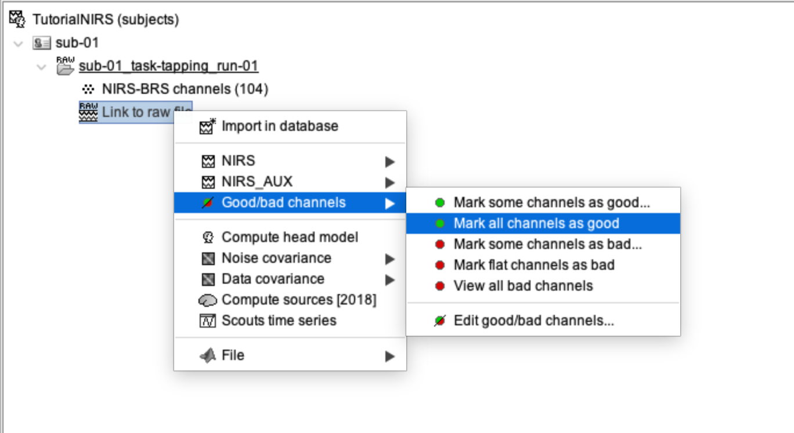
*Figure 8.8. Mark all channels as good resets the previous trial's channel-status flags.*

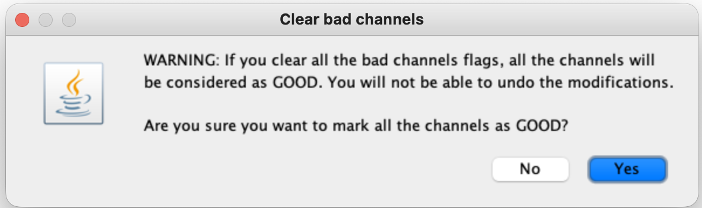
*Figure 8.9. Brainstorm warns that clearing the flags cannot be undone; use this command only when a rerun is intentional.*

!!! warning "Do not reset genuine exclusions casually"
    This reset was appropriate because the preceding run was an acknowledged threshold trial. In a real study, document the reason before clearing previously reviewed channel exclusions.

## 7. Run the revised tutorial criteria

Return **Link to raw file** to **Files to process**, reopen **Detect bad channels**, and use the settings that produced the final tutorial result:

- **Scalp Coupling Index:** off for this run;
- **Coefficient of variation:** on, threshold **30%**;
- **Remove saturating channels:** on;
- maximum saturating samples: **10%**;
- maximum flooring samples: **10%**;
- **Filter channels based on separation:** on, **0–5 cm**;
- **Auxiliary measurement:** **Remove all**.

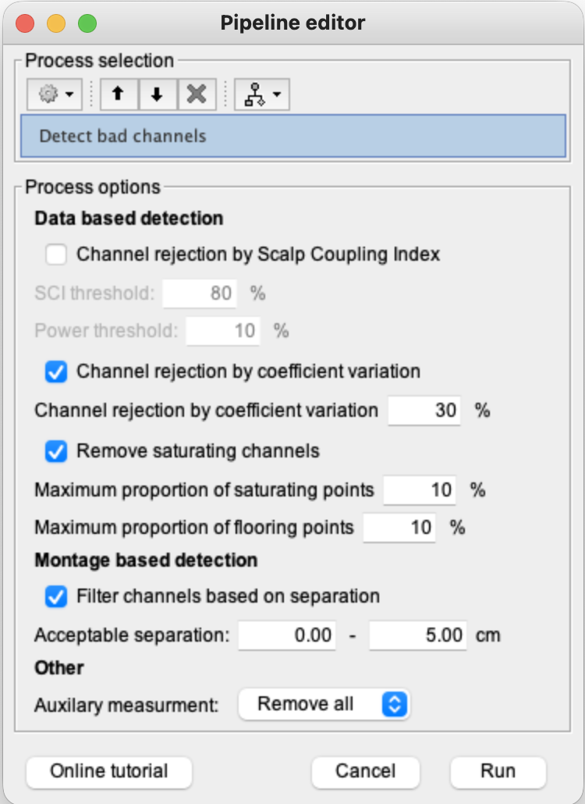
*Figure 8.10. The final run used CV, saturation/flooring and separation criteria without SCI rejection.*

Select **Run** and review the report rather than assuming the process succeeded because the window closed.

## 8. Record the final result

The revised run returned:

- **4 channels removed**, representing approximately **8%** of the channels;
- bad source–detector pairs: **S2D12, S2D14, S2D15 and S3D4**.

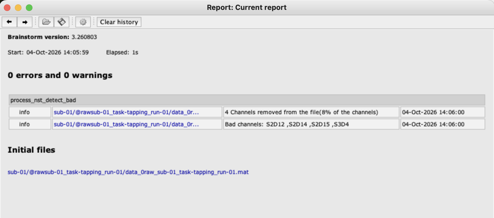
*Figure 8.11. The report documents the four source–detector pairs excluded by the active criteria.*

The report establishes that each listed pair failed at least one enabled criterion. It does **not** by itself identify whether a particular pair failed CV, saturation, flooring or separation. A criterion-specific diagnostic report or inspection of the raw wavelengths is needed before assigning an exact cause.

## What saturation and flooring mean in simple terms

- **Saturation:** the detector receives more light than it can measure. The signal reaches the instrument's ceiling and additional changes are lost.
- **Flooring:** the detector receives too little useful light. The signal lies near the instrument's floor and becomes dominated by instability or noise.

Both are range problems: one is **too much detected light**, while the other is **too little**.

## Checkpoint

Before continuing, verify that:

- the input was the original raw intensity link;
- the final report shows four excluded pairs rather than the earlier 43-channel trial;
- the recorded exclusions are **S2D12, S2D14, S2D15 and S3D4**;
- the original SNIRF file remains preserved outside the Brainstorm database;
- the quality settings and rejected channels are documented for later reporting.

## Troubleshooting

| Problem | Response |
|---|---|
| Almost every channel is rejected | Review which criteria are enabled and whether the thresholds are suitable; do not proceed automatically. |
| No visible output appears in the tree | Open the Brainstorm report/history: bad-channel detection primarily changes channel-status flags rather than creating a new time-series file. |
| Previous trial still affects the rerun | Intentionally reset through **Good/bad channels → Mark all channels as good**, then rerun once. |
| Unsure why a specific pair failed | Examine diagnostic quality indicators and both raw wavelengths; the summary bad-channel report may not specify the failed rule. |
| “Remove all” is shown instead of “Discard all” | Use the wording shown in the installed Brainstorm/NIRSTORM version; in our version the auxiliary option was **Remove all**. |

## Self-check {.quiz}

**1. Which file is used as input for bad-channel detection?**  
A. The original Link to raw file  
B. A haemoglobin average  
C. The cortical surface

Reveal answer after attempting
<strong>A.</strong> Quality screening begins with the original light-intensity recording.

**2. What is the main difference between Signal Quality Control and Detect bad channels?**  
A. Signal Quality Control exports indicators, while Detect bad channels applies thresholds to channel-status flags  
B. Only Signal Quality Control can open SNIRF files  
C. Detect bad channels creates participant anatomy

Reveal answer after attempting
<strong>A.</strong> One is primarily diagnostic; the other applies rejection decisions.

**3. What did the 43-channel result indicate in this exercise?**  
A. The first combination of criteria was probably too strict and needed review  
B. The dataset had exactly 43 participants  
C. The analysis was complete

Reveal answer after attempting
<strong>A.</strong> Rejecting about 90% of channels was an implausibly extreme result that prompted a threshold reset.

**4. Which four source–detector pairs were excluded in the final run?**  
A. S1D1, S1D2, S1D3 and S1D4  
B. S2D12, S2D14, S2D15 and S3D4  
C. Every S2 channel

Reveal answer after attempting
<strong>B.</strong> These were the four pairs listed in the final Brainstorm report.

**5. What does flooring indicate?**  
A. Detected light is near the lower useful measurement limit  
B. The detector receives more light than its upper limit  
C. The event duration is too short

Reveal answer after attempting
<strong>A.</strong> Flooring means the received intensity is too low for a stable useful measurement.

