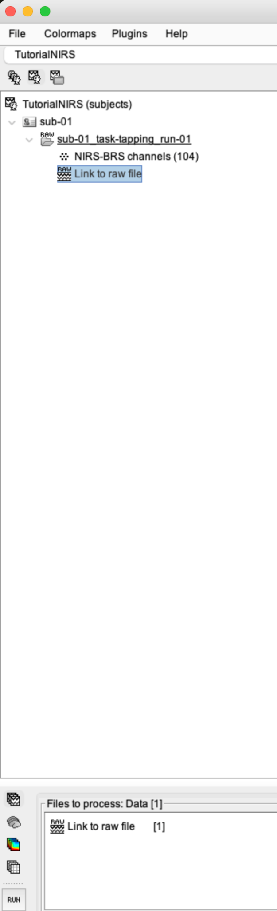
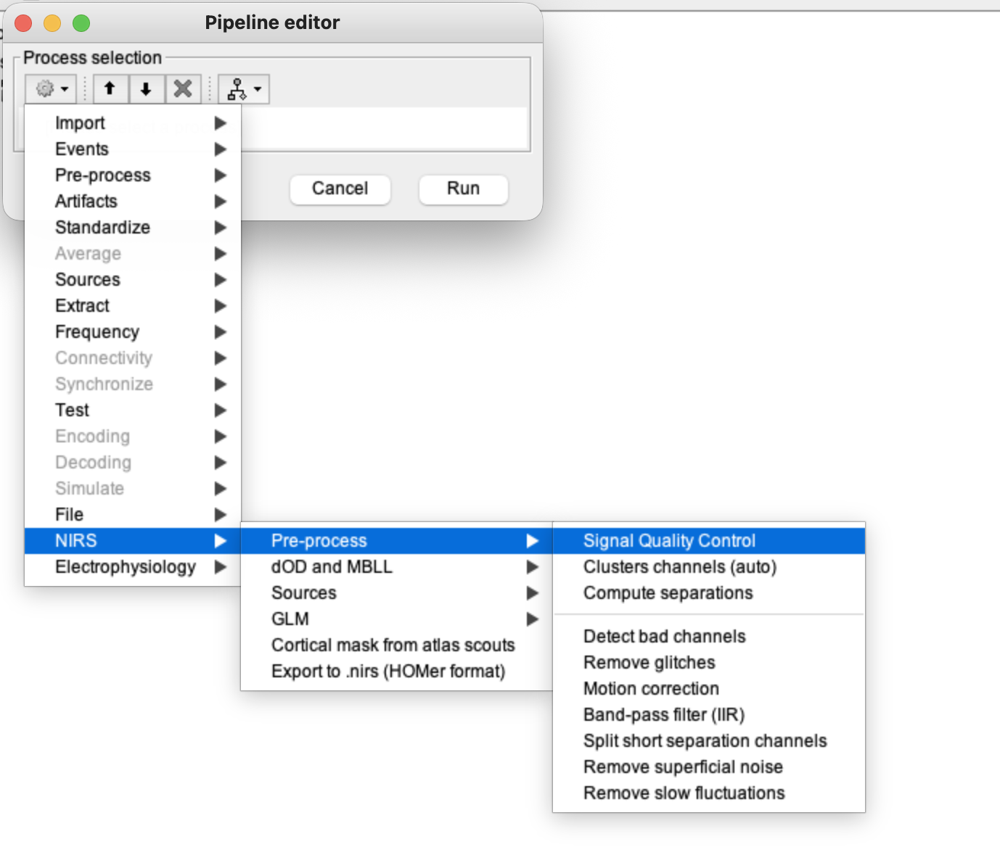
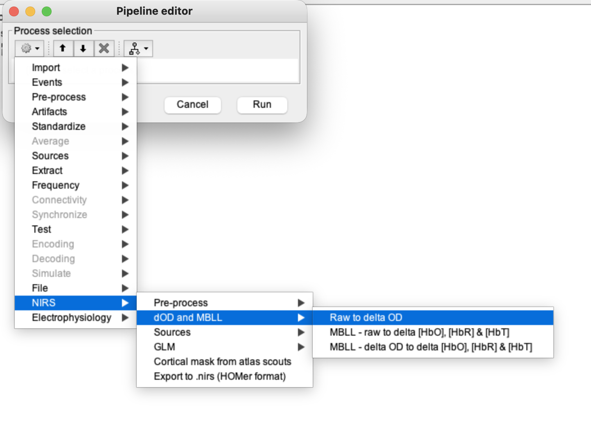
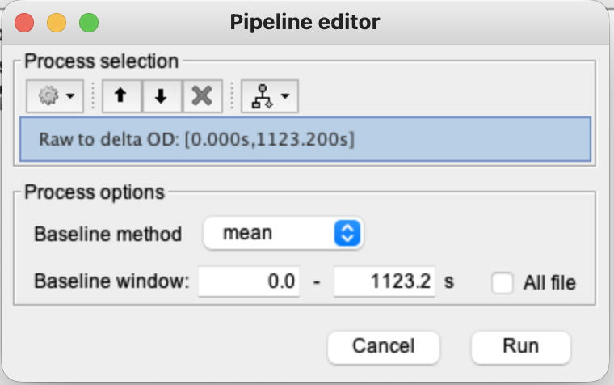
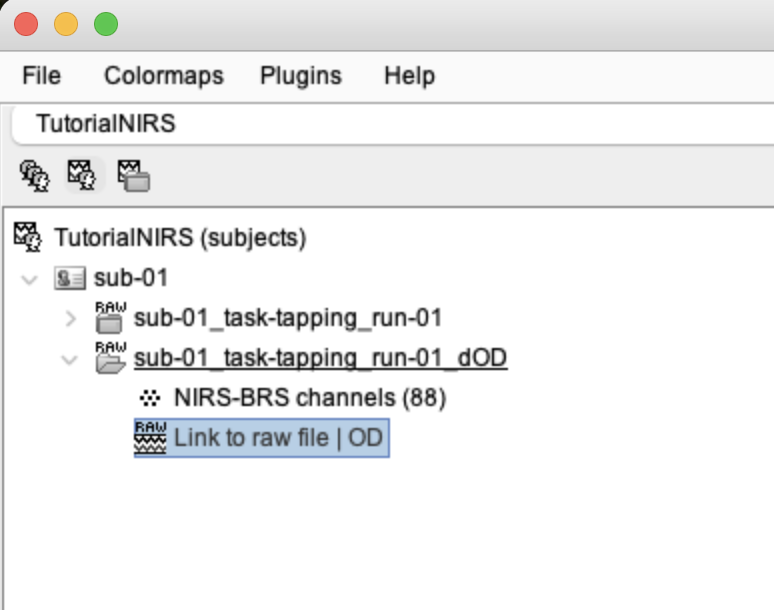
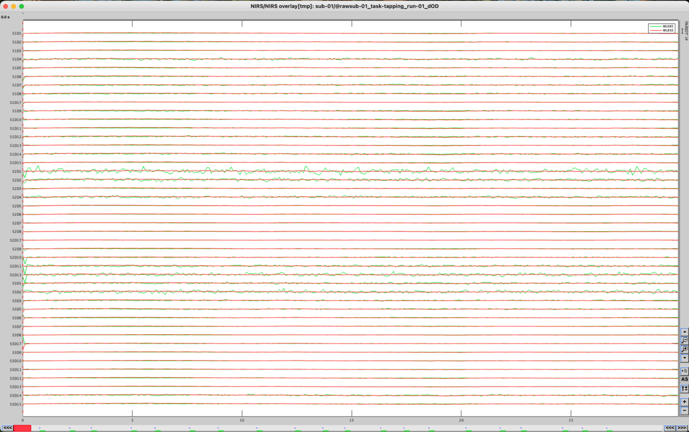
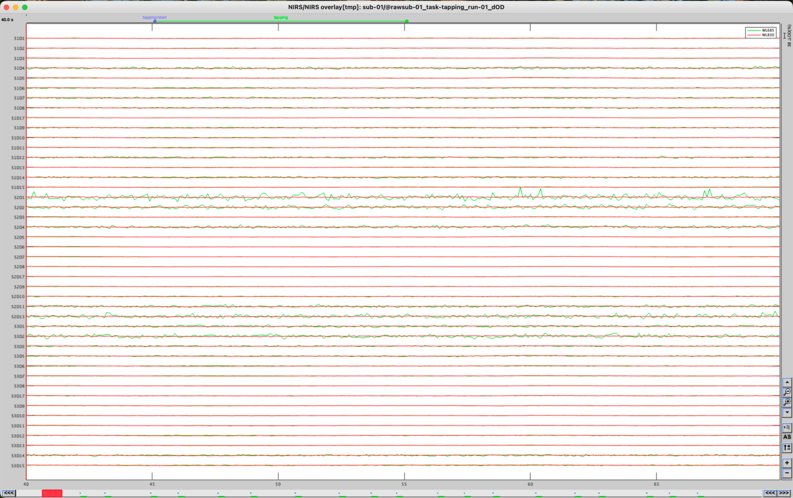

# Lesson 9 — Raw intensity to delta optical density

<strong>Status</strong> Complete

<strong>Input</strong> Quality-screened raw intensity

<strong>Output</strong> Raw | OD

## Aim

Convert detected-light intensity into **delta optical density (dOD)**, the relative absorption-change signal used for motion correction and later haemoglobin conversion.

## Where this lesson fits

> **Lesson 8:** identify unusable channels → **Lesson 9:** intensity to dOD → **Lesson 10:** motion correction.

Keep the original raw link. Brainstorm creates a derivative, so the two data stages remain distinguishable.

## Click-by-click procedure

### 1. Select the screened raw recording

1. Open the **Functional data** tree.
2. Expand the participant and run.
3. Select **Link to raw file** for the recording screened in Lesson 8.
4. Drag it into **Files to process** in the Process1 panel.

### 2. Open the optical-density conversion

1. Click **Run** at the lower-left of the Process1 panel.
2. In the Pipeline editor, open **NIRS**.
3. Open **Pre-process** or **dOD and MBLL** (the grouping can differ slightly by version).
4. Choose **Raw to delta optical density (dOD)**.

<figure><figcaption>Enter the NIRS preprocessing branch.</figcaption></figure>
<figure><figcaption>Select the raw-to-dOD process.</figcaption></figure>

### 3. Check the conversion options

1. Confirm the process is applied to the full recording.
2. Retain all required wavelengths and accepted channels.
3. Do not select an MRI or Hb file—the input must still be intensity data.
4. Click **Run**.

### 4. Confirm the new derivative

Expand the run and look for a new entry labelled **Raw | OD**. This is the dOD derivative; it is not a renamed copy of the original intensity recording.

### 5. Display and prepare it for Lesson 10

1. Double-click **Raw | OD** to display it.
2. Confirm that the time axis and channel structure are present.
3. Close the display if required.
4. Drag **Raw | OD**, not **Link to raw file**, into **Files to process** for motion correction.

<figure><figcaption>The converted dOD time series.</figcaption></figure>
<figure><figcaption>The correct input for Lesson 10.</figcaption></figure>

## Understanding dOD simply

dOD compares the light detected now with a reference level. A **positive dOD** means that relatively less light reached the detector, consistent with increased absorption. A **negative dOD** means that relatively more light reached the detector. It does not yet tell us whether HbO or HbR caused the change; that separation occurs in Lesson 11.

## Checkpoint

- The original intensity link remains in the tree.
- A separate **Raw | OD** derivative exists.
- **Raw | OD** is the file placed in **Files to process**.

## Troubleshooting

| Problem | Check |
|---|---|
| No OD output appears | Verify that an intensity recording, not an MRI or Hb result, was selected. |
| Conversion fails | Recheck bad-channel screening and look for zero, negative or saturated intensities. |
| Wrong file in Process1 | Clear the list and drag **Raw | OD** from the tree. |

## Self-check {.quiz}

**1. Which file enters the dOD conversion?**  
A. The quality-screened raw intensity recording  
B. The cortical surface  
C. The HbO source map

Reveal answer after attempting
<strong>A.</strong> dOD is calculated from detected-light intensity.

**2. A positive dOD generally means:**  
A. More light reached the detector  
B. Less light reached the detector relative to the reference  
C. The event was deleted

Reveal answer after attempting
<strong>B.</strong> Less detected light is consistent with greater absorption.

**3. Why screen channels before converting to dOD?**  
A. The logarithmic conversion needs valid intensity values  
B. To create the participant MRI  
C. To change the sampling rate

Reveal answer after attempting
<strong>A.</strong> Near-zero, invalid or saturated intensities can make the transform unreliable.

**4. What should appear after a successful conversion?**  
A. Raw | OD  
B. MNE sources | HbO  
C. segmentation_5tissues

Reveal answer after attempting
<strong>A.</strong> Brainstorm labels the new optical-density derivative Raw | OD.

**5. Which file should be placed in Files to process for Lesson 10?**  
A. Link to raw file  
B. Raw | OD  
C. MRI T1

Reveal answer after attempting
<strong>B.</strong> TDDR is applied to the optical-density derivative.

