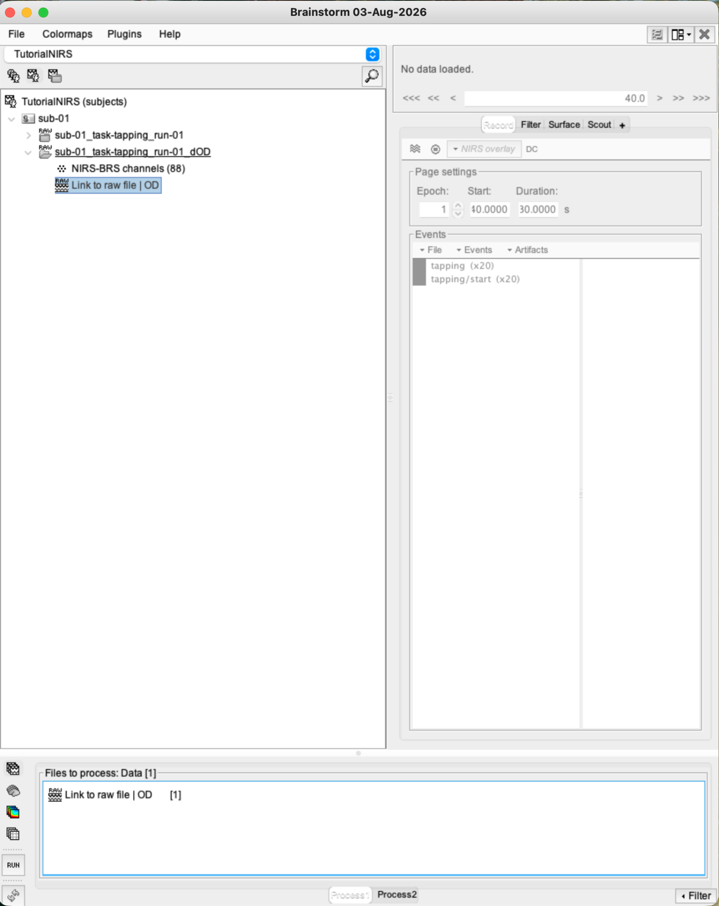
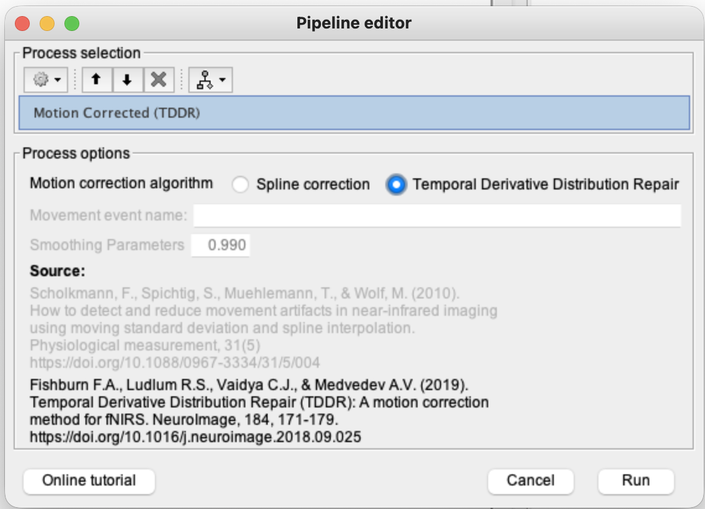
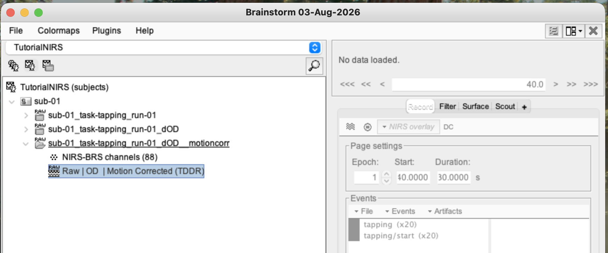

# Lesson 10 — Motion correction with TDDR

<strong>Status</strong> Complete

<strong>Input</strong> Raw | OD

<strong>Output</strong> TDDR-corrected dOD

## Aim

Reduce abrupt motion-related spikes and baseline shifts in dOD using **temporal derivative distribution repair (TDDR)**, then verify the result by comparing identical time windows.

## File lineage

> **Previous lesson:** raw intensity → **Raw | OD**.  
> **Current lesson:** **Raw | OD** → TDDR → corrected dOD.

### 1. Place the correct input in Process1

Drag **Raw | OD** into **Files to process**. The label must include OD; do not use the original raw-intensity link.

### 2. Find TDDR

1. Click **Run**.
2. Open **NIRS → Pre-process**.
3. Choose the motion-correction branch.
4. Select **TDDR** rather than spline correction for this lesson.

<figure><figcaption>Open the NIRS motion-correction tools.</figcaption></figure>
<figure><figcaption>Choose TDDR from the available methods.</figcaption></figure>

### 3. Run the process

Check that the process heading identifies TDDR and the file list contains the dOD recording. Use the tutorial/default TDDR settings, then click **Run**.

### 4. Confirm the corrected derivative

A new motion-corrected OD result should appear beneath the run. Keep both the uncorrected and corrected versions so they can be compared.

### 5. Compare the same short interval

1. Open the original **Raw | OD** and set **Start = 0 s**, **Duration = 30 s**.
2. Open the TDDR result and use the same 0–30 s window.
3. Keep the same channel layout and display scale where possible.
4. Look for reduced steps or spikes without flattening the slow signal.

<figure><figcaption>Before TDDR: 0–30 s.</figcaption></figure>
<figure><figcaption>After TDDR: the matched interval.</figcaption></figure>

### 6. Inspect the entire recording

Display the full recording before and after correction. A full view helps locate candidate motion periods; a short matched view then shows whether TDDR altered them appropriately.

<figure><figcaption>Entire recording before TDDR.</figcaption></figure>
<figure><figcaption>Entire recording after TDDR.</figcaption></figure>

## Why TDDR?

TDDR identifies unusually large temporal derivatives and downweights their influence. It is useful here because it operates directly on dOD and does not require every movement to be marked manually. It is not a guarantee that all motion has disappeared, so visual verification remains essential.

!!! caution
    A before/after comparison is only meaningful when the time window, channel selection and display scale are matched.

## Checkpoint

- The input was **Raw | OD**.
- A separate TDDR-corrected OD derivative exists.
- Full-recording and matched short-window comparisons were inspected.

## Troubleshooting

| Problem | Check |
|---|---|
| TDDR is missing | Confirm NIRSTORM is enabled and look under **NIRS → Pre-process**. |
| Plots look identical | Confirm that one window is original dOD and the other is the corrected derivative. |
| Comparison is confusing | Enter the same Start and Duration values and use the same channels. |

## Self-check {.quiz}

**1. TDDR is applied to which data stage here?**  
A. dOD  
B. MRI T1  
C. Cortical scout labels

Reveal answer after attempting
<strong>A.</strong> The motion correction is run on the optical-density time series.

**2. TDDR primarily targets:**  
A. Motion-related abrupt temporal changes  
B. Missing MRI tissue classes  
C. Incorrect event names

Reveal answer after attempting
<strong>A.</strong> TDDR downweights extreme temporal derivatives associated with movement.

**3. What is the strongest visual verification?**  
A. Compare matched intervals before and after  
B. Delete the original immediately  
C. Compare different channels at different times

Reveal answer after attempting
<strong>A.</strong> Matched displays isolate the effect of the processing step.

**4. Why retain the uncorrected dOD file?**  
A. To provide an audit trail and comparison  
B. Because TDDR changes the MRI  
C. To create extra events

Reveal answer after attempting
<strong>A.</strong> Keeping both versions makes the correction transparent and reproducible.

**5. Does TDDR prove that all motion artefacts are gone?**  
A. Yes, automatically  
B. No, the result still requires inspection  
C. Only if HbT is hidden

Reveal answer after attempting
<strong>B.</strong> Residual artefacts or overcorrection can remain.

