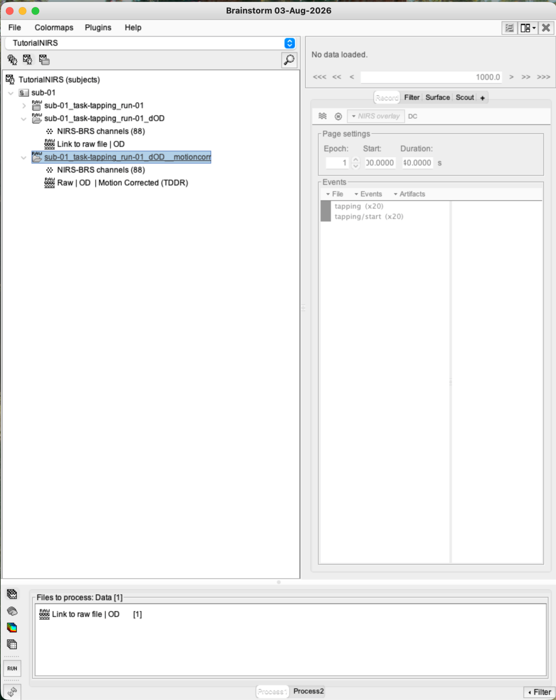
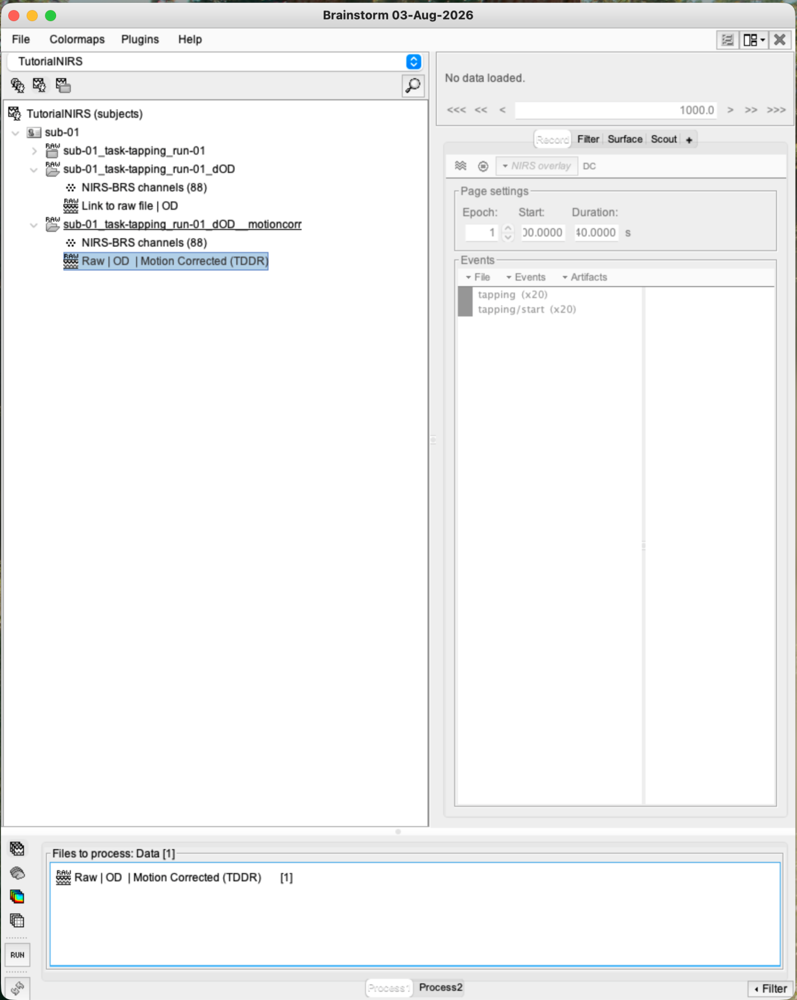
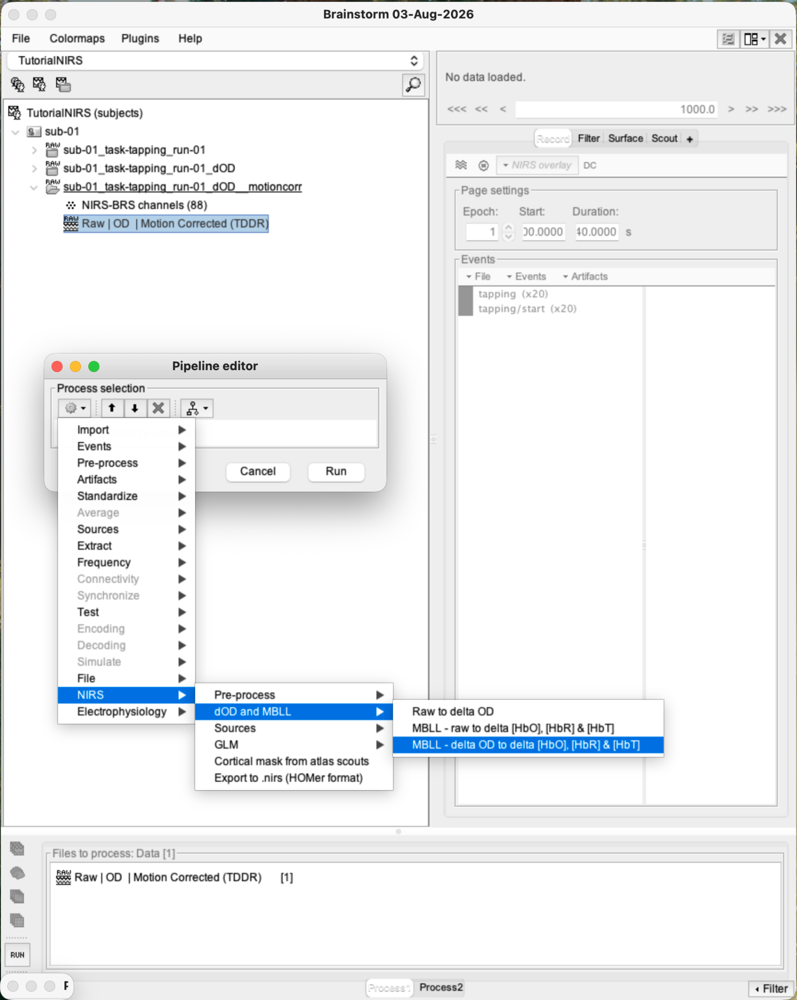
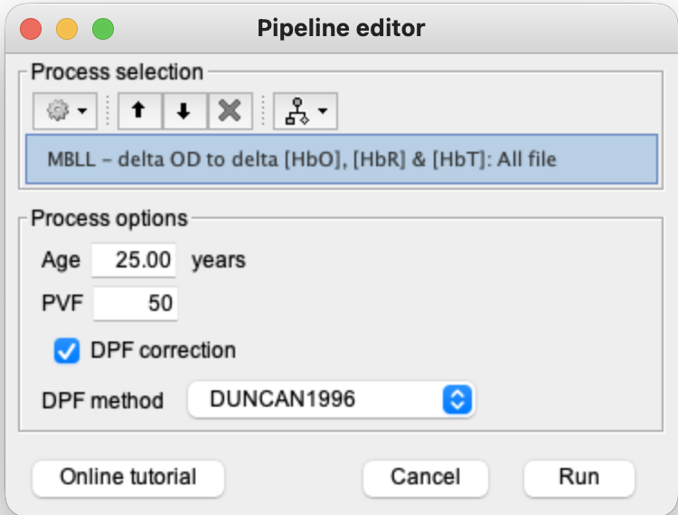
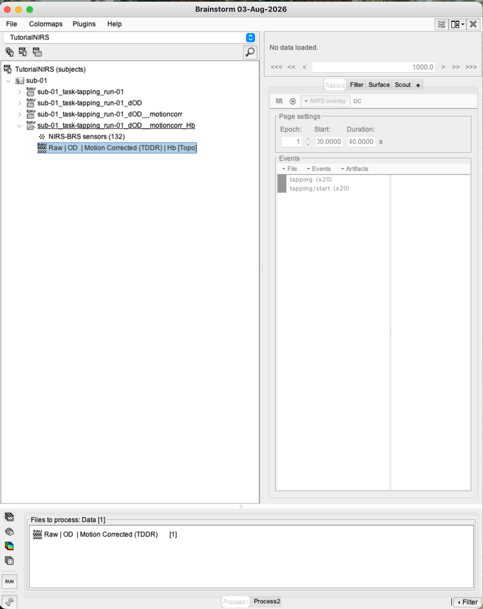
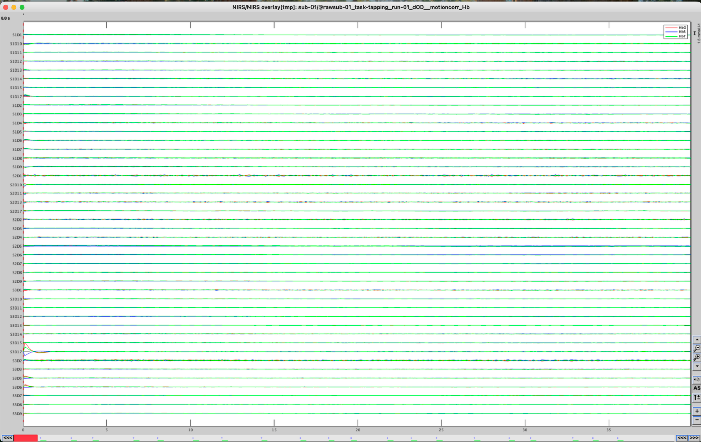
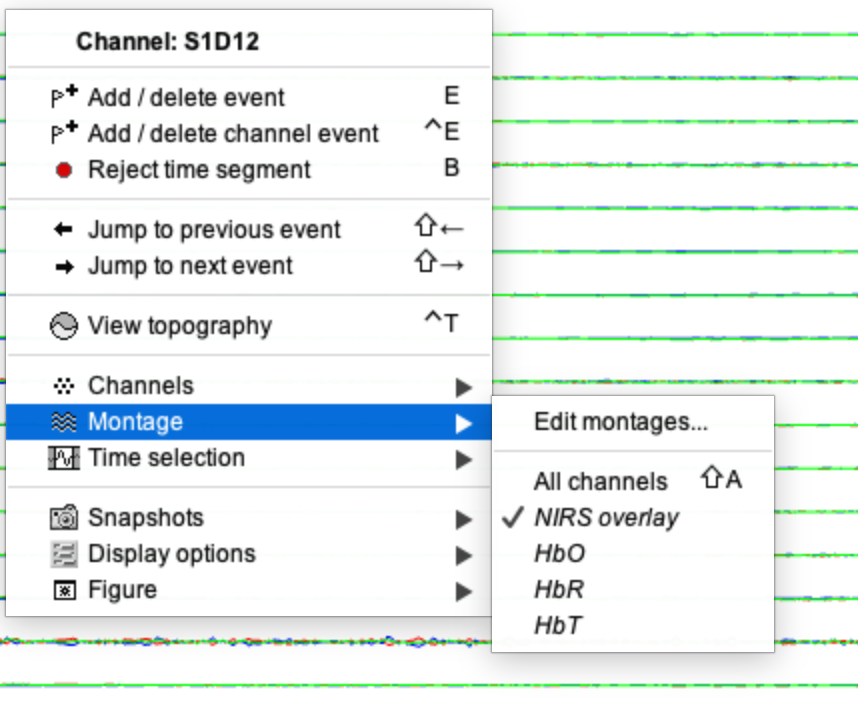
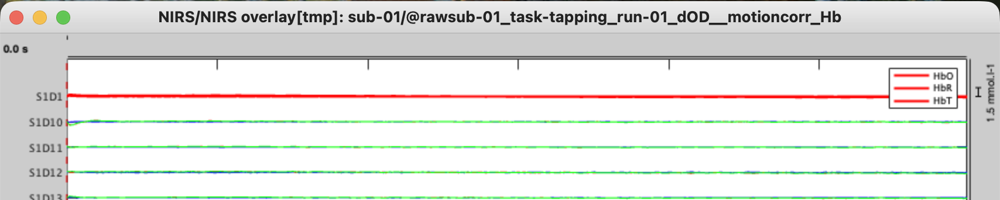

# Lesson 11 — Convert dOD to haemoglobin with MBLL

<strong>Status</strong> Complete

<strong>Input</strong> TDDR-corrected dOD

<strong>Output</strong> Hb [Topo]: HbO, HbR and HbT

## Aim

Apply the **modified Beer–Lambert law (MBLL)** to estimate concentration changes in oxygenated haemoglobin (HbO), deoxygenated haemoglobin (HbR) and total haemoglobin (HbT).

## File lineage

> Raw intensity → dOD → TDDR-corrected dOD → **MBLL haemoglobin conversion**.

### 1. Select the corrected dOD input

Select the motion-corrected OD result from Lesson 10 and place it in **Files to process**.

### 2. Open the conversion process

1. Click **Run** to open the Pipeline editor.
2. Open **NIRS → dOD and MBLL**.
3. Choose the process that converts dOD to haemoglobin using MBLL.

<figure><figcaption>The corrected dOD is the only input.</figcaption></figure>
<figure><figcaption>Select the dOD-to-haemoglobin process.</figcaption></figure>

### 3. Review the MBLL settings

1. Enter the participant age used for the training example (**25 years** in our run).
2. Keep the age-dependent DPF correction enabled.
3. Keep the selected extinction-coefficient model shown in the tutorial run.
4. Record every displayed pathlength setting as an analysis parameter.
5. Click **Run**.

!!! note "For real studies"
    Use each participant's actual age. Do not apply the training age of 25 years to an entire cohort unless it is genuinely correct for every participant.

### 4. Confirm the Hb output

Expand the output tree and locate **Hb [Topo]**. `Hb` identifies haemoglobin-derived channels; `[Topo]` means their source–detector montage information is retained for topographic displays.

### 5. Display the haemoglobin time series

1. Double-click **Hb [Topo]**.
2. Start with the overview to confirm the recording opens correctly.
3. Use **Display** and the channel controls to isolate a source–detector pair if desired.
4. Confirm that HbO, HbR and HbT traces are available.

<figure><figcaption>Overview of the haemoglobin recording.</figcaption></figure>
<figure><figcaption>Choose a pair or chromophore through Display.</figcaption></figure>

Do not infer a verified task response from one unfiltered pair at this stage. The purpose is to confirm the conversion and identify the three chromophores.

## Batch-analysis rule

Maintain a table containing participant ID, age and MBLL settings. If ages differ, run or script the conversion using the correct value for each participant and keep the DPF model consistent.

## Checkpoint

- The input was TDDR-corrected dOD.
- **Hb [Topo]** exists.
- HbO, HbR and HbT can be displayed.
- Participant age and MBLL assumptions were recorded.

## Self-check {.quiz}

**1. MBLL converts dOD into estimates of:**  
A. HbO, HbR and HbT changes  
B. MRI tissue volumes  
C. Event durations

Reveal answer after attempting
<strong>A.</strong> MBLL separates wavelength-specific absorption changes into chromophore concentration changes.

**2. Why is participant age entered?**  
A. It informs the differential pathlength estimate  
B. It renames the channels  
C. It selects tapping events

Reveal answer after attempting
<strong>A.</strong> Age is used by the selected pathlength model.

**3. What does [Topo] indicate?**  
A. The montage information is retained  
B. The data are statistically significant  
C. The MRI has been deleted

Reveal answer after attempting
<strong>A.</strong> The channel data can still be related to their montage.

**4. For participants with different ages, you should:**  
A. Use the correct age for each participant  
B. Enter 25 for everyone  
C. Omit MBLL

Reveal answer after attempting
<strong>A.</strong> Subject-specific ages should be linked to their conversion runs.

**5. At this point, one isolated channel should be treated as:**  
A. Proof of activation  
B. A conversion/display check, not a verified response  
C. A cortical reconstruction

Reveal answer after attempting
<strong>B.</strong> Filtering, epoch review and averaging still follow.

