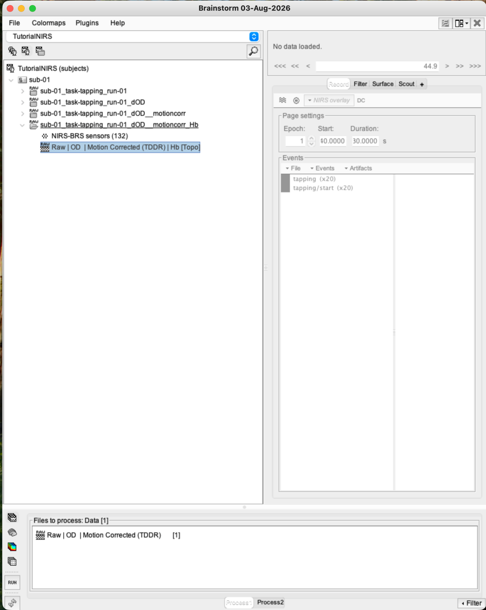
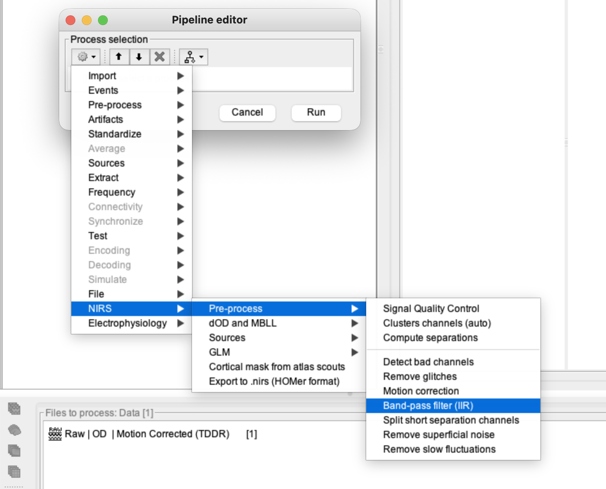
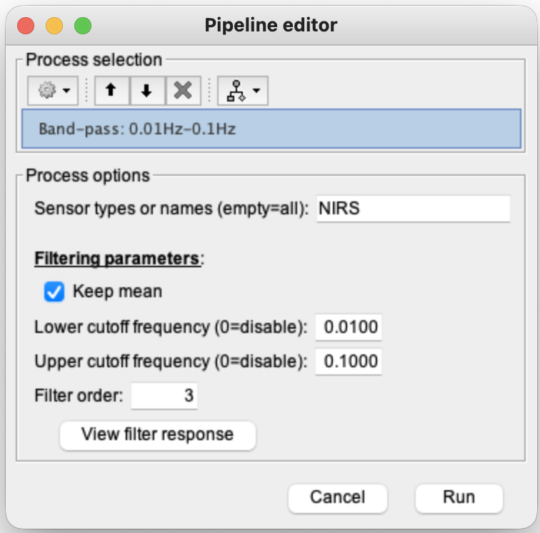
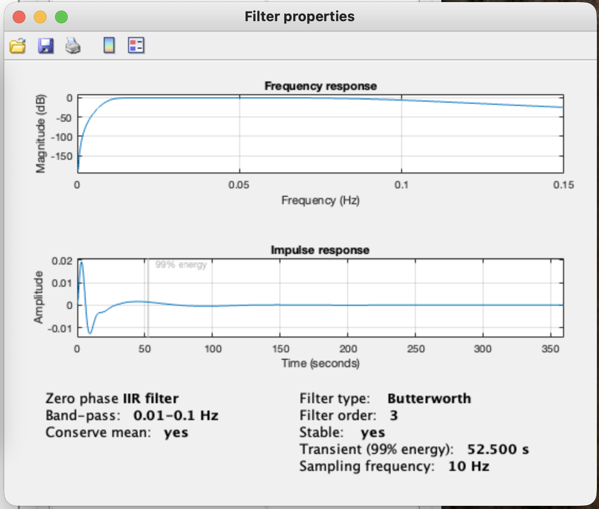
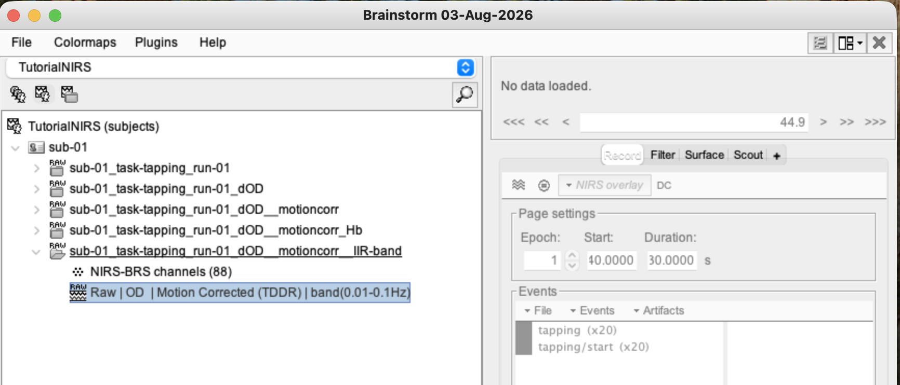
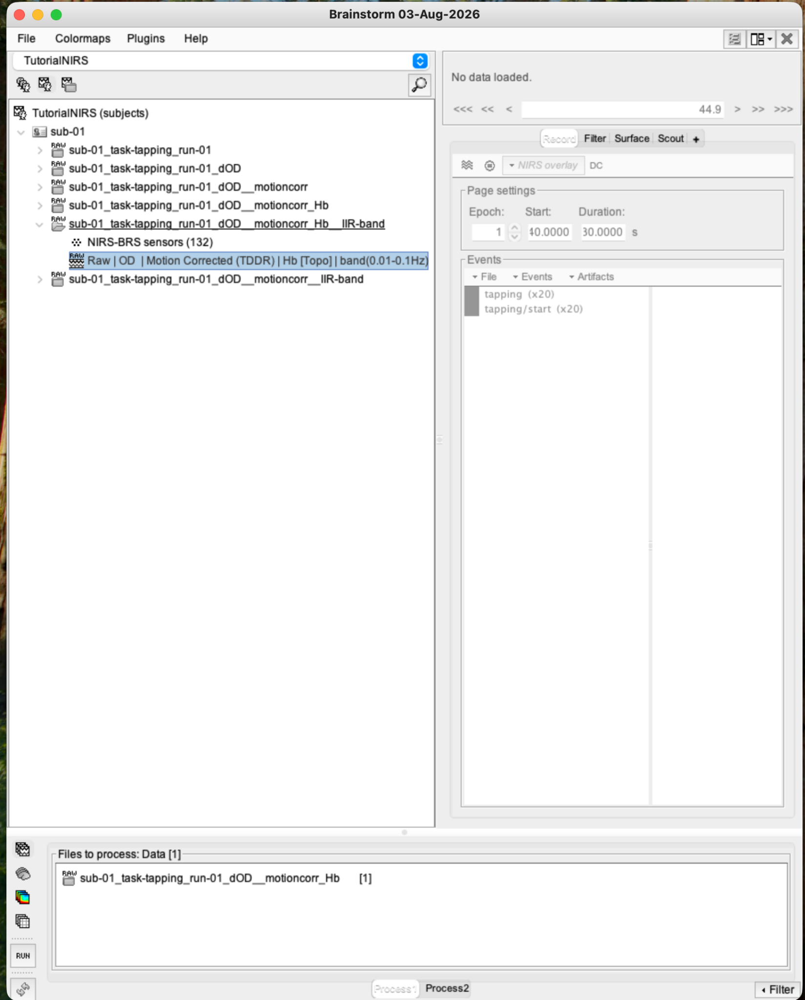
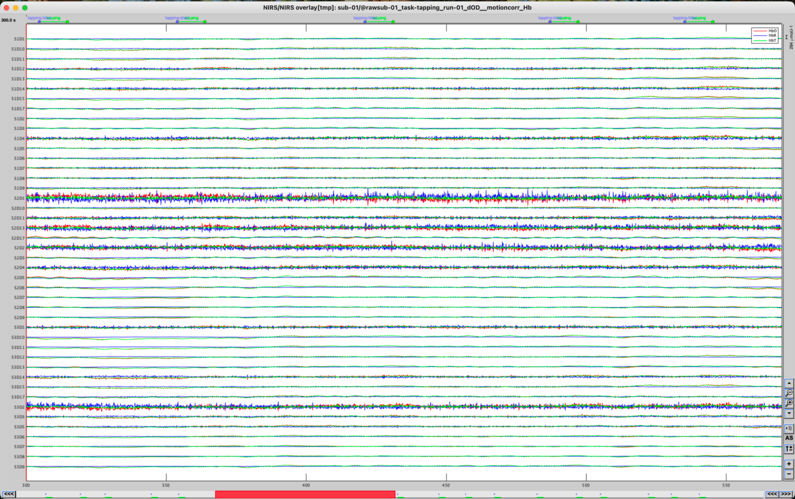
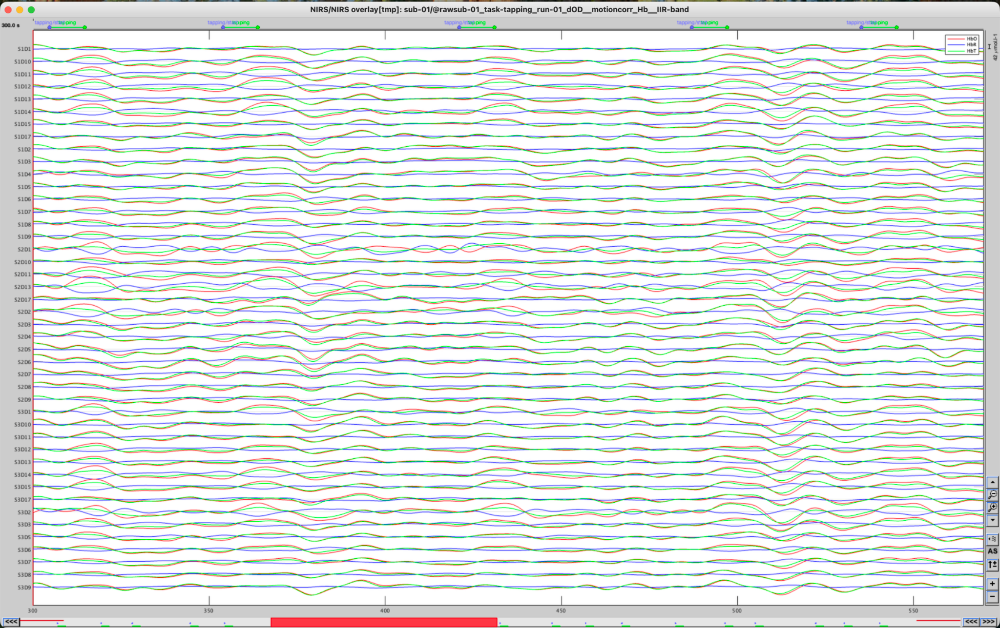

# Lesson 12 — Band-pass filtering

<strong>Status</strong> Complete

<strong>Input</strong> TDDR-corrected Hb [Topo]

<strong>Output</strong> IIR-band Hb

## Aim

Reduce slow drift and faster physiological fluctuations while retaining the slower task-related haemodynamic response.

## File lineage

> **Lesson 11:** corrected dOD → MBLL → Hb [Topo].  
> **Lesson 12:** select that Hb derivative → IIR band-pass filter → filtered Hb.

### 1. Select the Lesson 11 output

Select **Hb [Topo]** beneath the TDDR-corrected branch and drag it to **Files to process**. Do not return to raw intensity or uncorrected OD.

### 2. Open the IIR band-pass filter

1. Click **Run**.
2. Open **NIRS → Pre-process**.
3. Select the **IIR band-pass filter** in the Brainstorm 2026 interface.

### 3. Enter the training settings

| Setting | Value |
|---|---|
| High-pass edge | 0.01 Hz |
| Low-pass edge | 0.10 Hz |
| Filter type | IIR/Butterworth, zero-phase as displayed |
| Filter order | 3 |
| Keep mean | Selected |

These are teaching settings for this dataset, not universal defaults. A study should justify its passband before inspecting outcomes.

### 4. View the response before running

Click **View filter response**. Confirm that the passband lies between 0.01 and 0.10 Hz and that the properties match the intended process. Close the response window, then click **Run**.

### 5. Find the output—not the input

A new branch labelled **IIR-band** should appear. Expand it and select its Hb output.

<figure><figcaption>The new filtered branch.</figcaption></figure>
<figure><figcaption>Select the derivative inside IIR-band.</figcaption></figure>

### 6. Compare filtered and unfiltered data

Open both versions with the same time window and scale. Filtering should reduce slow baseline wander and high-frequency variation without erasing the slower haemodynamic structure.

<figure><figcaption>Before band-pass filtering.</figcaption></figure>
<figure><figcaption>After band-pass filtering.</figcaption></figure>

## Important cautions

- Filtering cannot rescue a saturated or uncoupled channel.
- Aggressive filtering can distort response timing and amplitude.
- Edge transients may occur near the start and end; inspect the first epoch carefully.

## Checkpoint

- The input was TDDR-corrected Hb.
- The exercise passband was 0.01–0.10 Hz.
- The output was opened from the **IIR-band** branch.

## Troubleshooting

| Problem | Check |
|---|---|
| No filtered output appears | Confirm the Hb file was in Files to process and Run completed. |
| Display looks unchanged | Verify that you opened the derivative under IIR-band. |
| Large distortion at the beginning | Treat it as a possible edge effect and inspect the first epoch. |

## Self-check {.quiz}

**1. Which file entered the filter?**  
A. TDDR-corrected Hb [Topo]  
B. MRI T1  
C. Original intensity only

Reveal answer after attempting
<strong>A.</strong> The lesson filters the haemoglobin derivative produced by MBLL.

**2. What passband was used?**  
A. 0.01–0.10 Hz  
B. 1–40 Hz  
C. 100–200 Hz

Reveal answer after attempting
<strong>A.</strong> This retains slow fNIRS task-related variation while attenuating slower drift and faster noise.

**3. Why view the filter response?**  
A. To verify the numerical specification  
B. To create events  
C. To register MRI

Reveal answer after attempting
<strong>A.</strong> It checks that the intended frequency band is retained.

**4. Where is the result found?**  
A. In the new IIR-band branch  
B. Under MRI only  
C. In the scout atlas

Reveal answer after attempting
<strong>A.</strong> Brainstorm preserves the input and creates a filtered derivative.

**5. Why inspect the beginning of the filtered recording?**  
A. Filter-edge transients can appear there  
B. HbO is never present there  
C. It changes participant age

Reveal answer after attempting
<strong>A.</strong> Edge effects may contaminate an early epoch.

