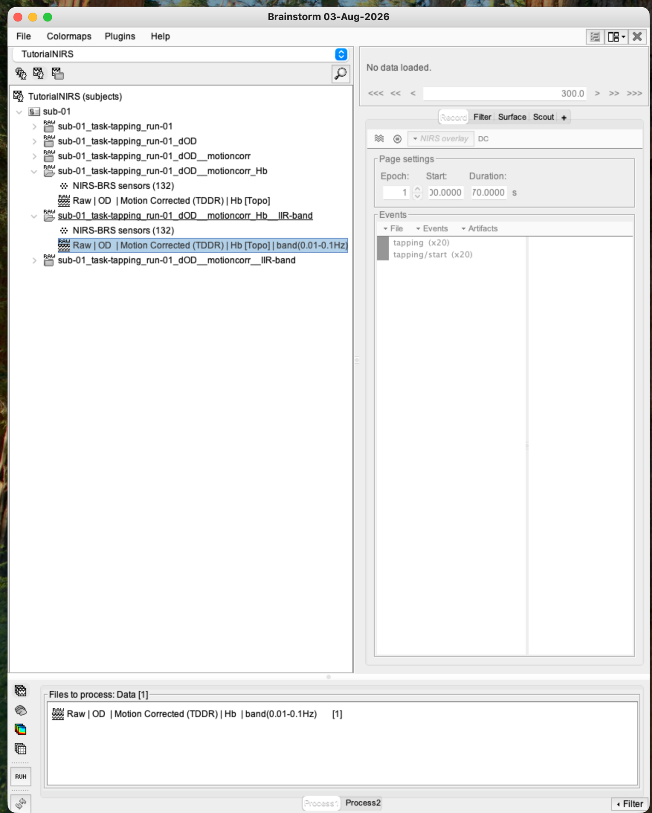
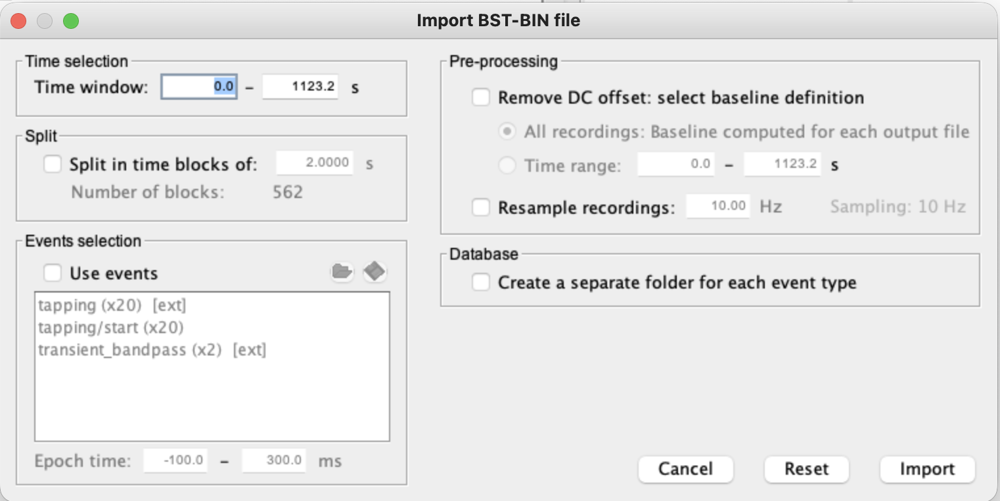
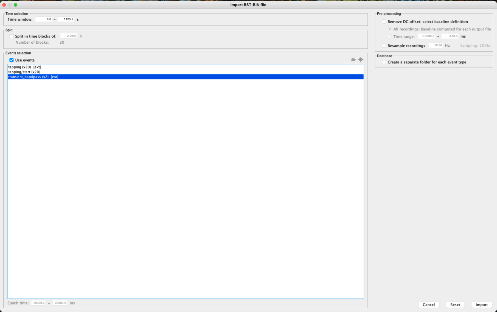
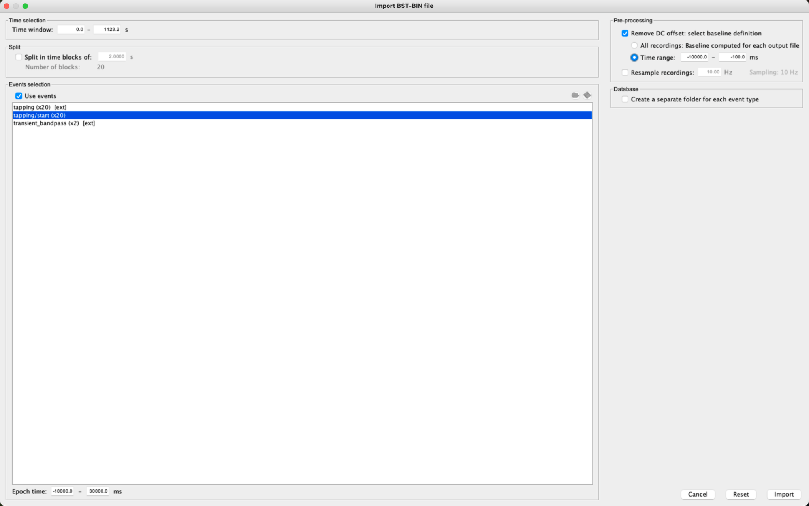
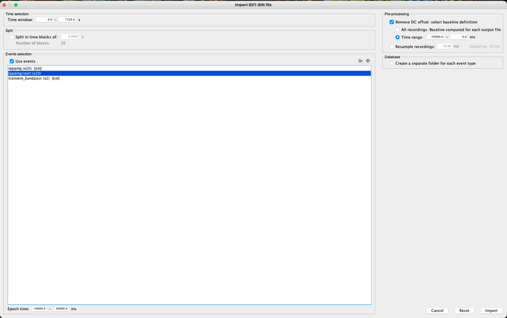
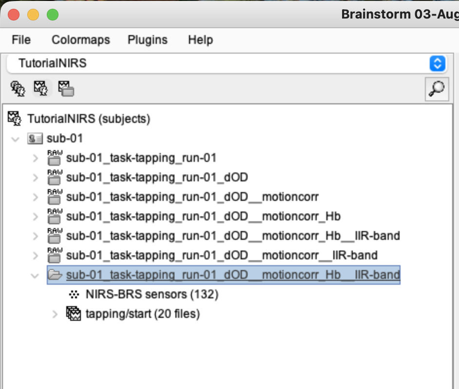
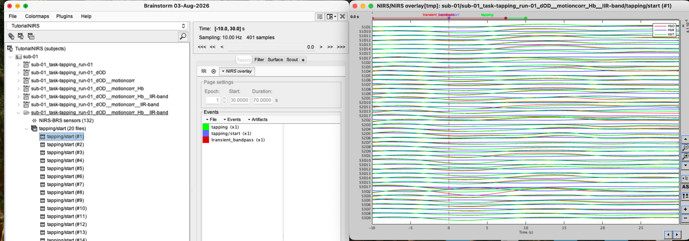
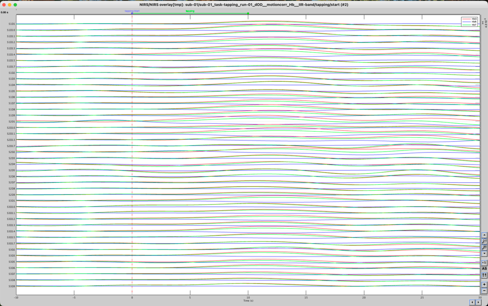
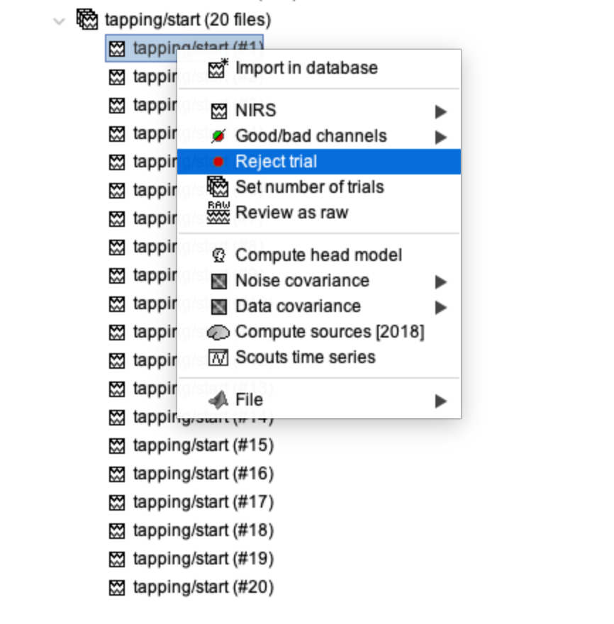

# Lesson 13 — Epoching, baseline correction and trial review

<strong>Status</strong> Complete

<strong>Input</strong> Filtered Hb in IIR-band

<strong>Output</strong> 20 task-locked epochs; 19 accepted

## Aim

Cut the continuous filtered recording into comparable windows around each `tapping/start` event, apply a prestimulus baseline, and reject contaminated trials before averaging.

## File lineage

> **Lesson 12 output:** filtered Hb under **IIR-band** → **Lesson 13:** import event-locked epochs → review every trial.

### 1. Select the filtered Hb file

Expand the **IIR-band** branch and select its Hb recording. This is the filtered output, not the parent unfiltered file.

### 2. Open Import in database

Right-click the selected recording and choose **Import in database**. Brainstorm opens the **Import BST-BIN file** dialogue.

### 3. Select the event group

1. Check **Use events**.
2. Select **tapping/start (×20)**, the simple onset group created in Lesson 7.
3. Do not select the extended `tapping` group for this onset-locked exercise.

### 4. Enter epoch and baseline settings

Use the settings visible in the final import dialogue:

| Setting | Value |
|---|---|
| Epoch time | −10,000 to +30,000 ms |
| Remove DC offset | Selected |
| Baseline time range | −10,000 to 0 ms |
| Event group | `tapping/start (×20)` |

<figure><figcaption>Set the epoch and baseline windows.</figcaption></figure>
<figure><figcaption>Final check before Import.</figcaption></figure>

Click **Import**. A `tapping/start` condition containing 20 files should appear.

### 5. Inspect the epochs individually

1. Expand `tapping/start (20 files)`.
2. Open the first epoch and inspect all traces.
3. Continue through later epochs, checking the entire −10 to +30 s interval.

<figure><figcaption>The first epoch showed a likely filter-edge transient.</figcaption></figure>
<figure><figcaption>A later epoch used for comparison.</figcaption></figure>

### 6. Reject the contaminated trial

For the first epoch in this training run:

1. Right-click the epoch in the database tree.
2. Open **Good/bad channels**.
3. Click **Reject trial**.
4. Confirm that it is marked bad while the remaining epochs stay available.

The tree still describes 20 imported files, but only **19 accepted epochs** should enter the average.

## Why epochs matter

Both EEG and fNIRS use epochs: repeated segments aligned to a common event. fNIRS epochs are longer because haemodynamic responses unfold over seconds. Baseline correction expresses each trial relative to its own prestimulus level.

!!! caution
    Trial rejection must be based on visible quality problems, not on whether a response looks theoretically desirable.

## Checkpoint

- `tapping/start (×20)` was selected.
- Epochs span −10 to +30 s.
- Baseline spans −10 to 0 s.
- The first contaminated epoch was rejected; 19 remain accepted.

## Troubleshooting

| Problem | Check |
|---|---|
| No tapping/start group appears | Return to Lesson 7 and verify the simple onset group was created and saved. |
| Epoch count is not 20 | Confirm that only `tapping/start (×20)` is selected. |
| Reject trial seems to delete everything | Verify that one epoch, not the whole condition folder, was selected. |

## Self-check {.quiz}

**1. What defines time zero for each epoch?**  
A. The tapping/start onset  
B. The HbO peak  
C. MRI fiducial NAS

Reveal answer after attempting
<strong>A.</strong> Every segment is aligned to the simple tapping onset.

**2. What epoch interval was used?**  
A. −10 to +30 s  
B. 0 to 1 s  
C. −100 to +100 s

Reveal answer after attempting
<strong>A.</strong> The import dialogue shows −10,000 to +30,000 ms.

**3. What was the baseline interval?**  
A. −10 to 0 s  
B. 10 to 20 s  
C. The entire recording

Reveal answer after attempting
<strong>A.</strong> The prestimulus period provides the reference level.

**4. Why was the first trial rejected?**  
A. A likely filter-edge transient contaminated it  
B. It lacked an MRI  
C. Its HbO response was too small

Reveal answer after attempting
<strong>A.</strong> Rejection was based on signal quality, not desired biology.

**5. How many accepted trials remained?**  
A. 19  
B. 20  
C. 2

Reveal answer after attempting
<strong>A.</strong> One of the 20 imported epochs was rejected.

