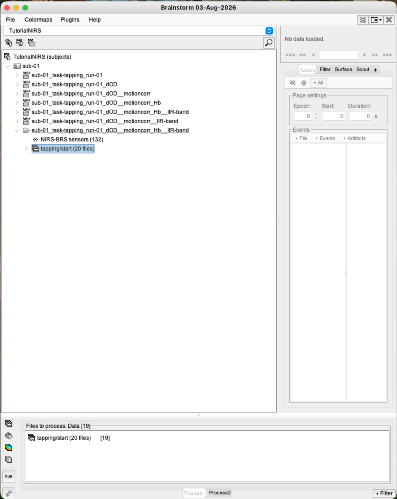
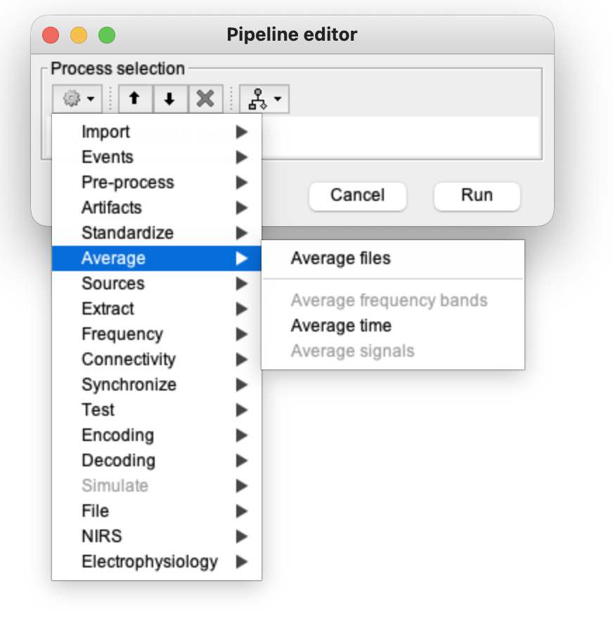
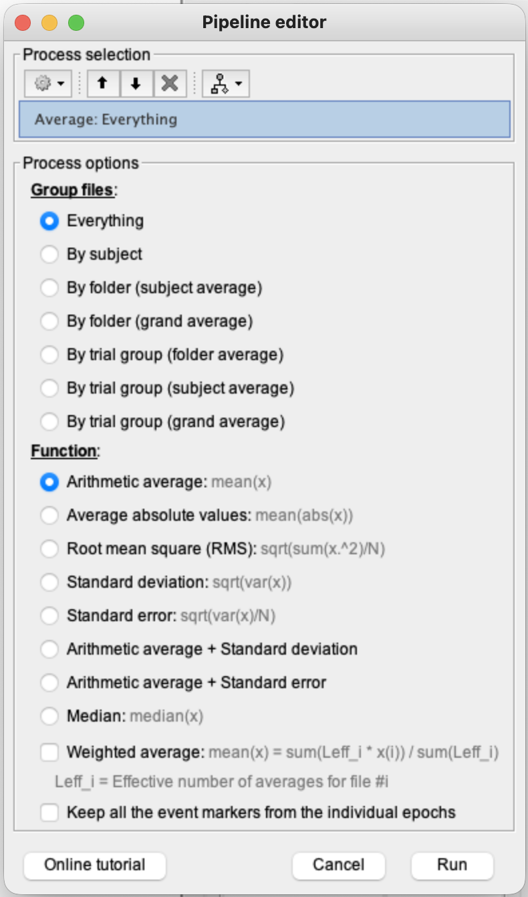
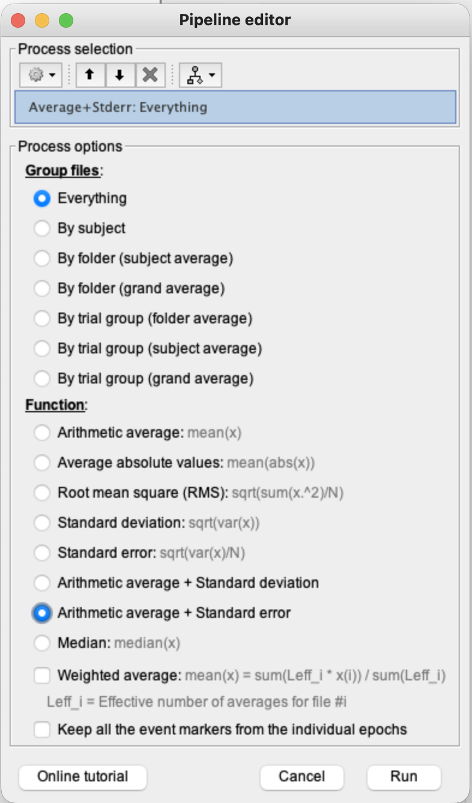
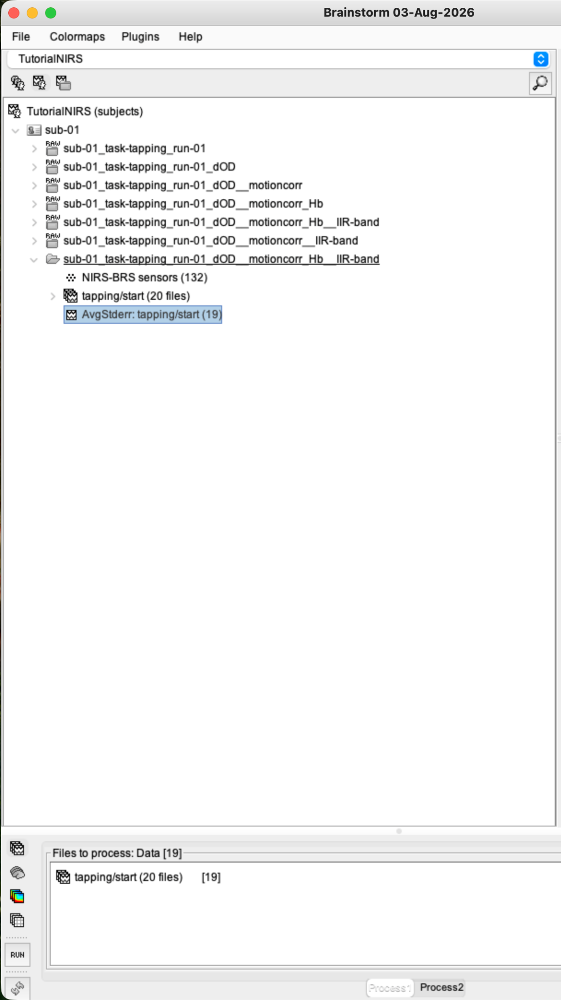
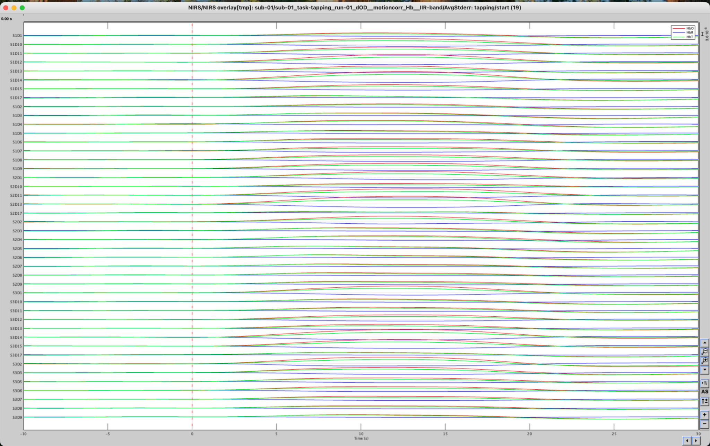
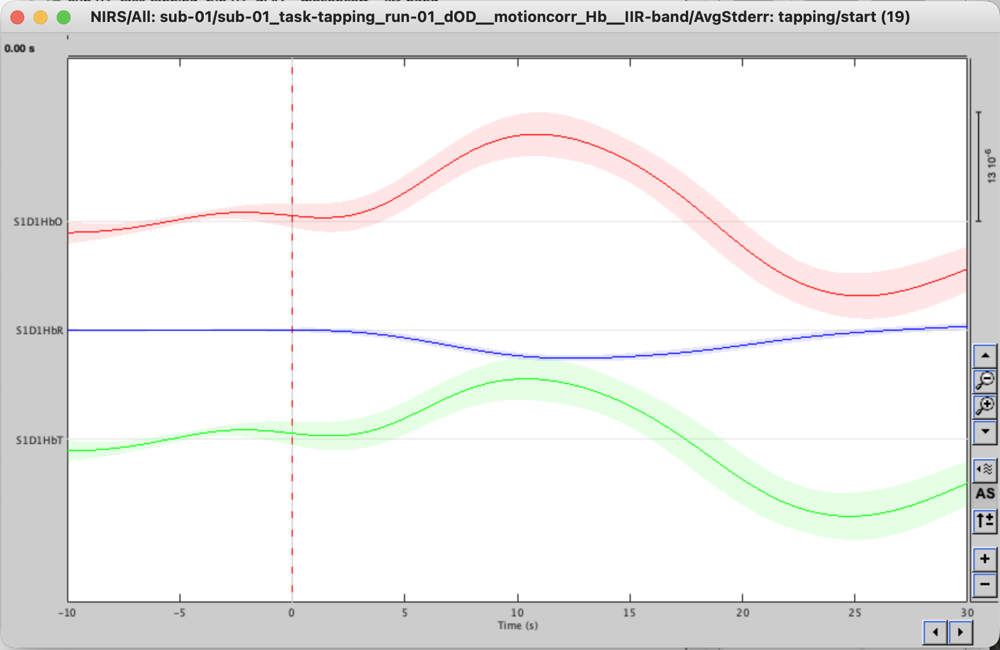

# Lesson 14 — Block averaging

<strong>Status</strong> Complete

<strong>Input</strong> 19 accepted tapping epochs

<strong>Output</strong> AvgStderr: tapping/start (19)

## Aim

Average the accepted task-locked epochs to estimate the repeatable finger-tapping haemodynamic response.

## File lineage

> **Lesson 13:** 20 imported epochs, first trial rejected → **Lesson 14:** average the 19 accepted trials.

### 1. Confirm the epoch group

Open the Functional data tree and select the `tapping/start` condition. Brainstorm may still display 20 files in the folder name; the rejected trial is excluded when accepted data are processed.

### 2. Send accepted epochs to Process1

1. Select the `tapping/start` group.
2. Drag it into **Files to process**.
3. Confirm the process panel represents the accepted trials rather than the continuous recording.

### 3. Open the general Average process

1. Click **Run**.
2. Open **Average** in the general Brainstorm process menu.
3. Select **Average files**.

Why is this not under NIRS? Averaging is a modality-independent Brainstorm operation used with EEG, MEG and fNIRS.

### 4. Set the average options

In our single-condition, single-participant run:

1. Select **Everything** under Group files.
2. Select **Arithmetic average: mean(x)**.
3. Keep only the intended tapping epochs in the file list.
4. Click **Run**.

<figure><figcaption>Arithmetic average across the supplied epochs.</figcaption></figure>
<figure><figcaption>Final process check before running.</figcaption></figure>

### 5. Locate the result

Expand the condition folder and locate **AvgStderr: tapping/start (19)**. The `(19)` confirms that the rejected trial was not included.

### 6. Inspect the average

Double-click the average result. Begin with the overview, then isolate a source–detector pair for a clearer HbO/HbR/HbT display.

<figure><figcaption>Overview of the block-average result.</figcaption></figure>
<figure><figcaption>Representative pair with mean traces and uncertainty shading.</figcaption></figure>

## Interpretation

Averaging strengthens features that recur at a similar latency after tapping onset and reduces unrelated trial-to-trial variation. It does not remove artefacts that recur systematically, nor does it establish statistical significance.

## Checkpoint

- Only accepted epochs entered Process1.
- Arithmetic average was selected.
- The output reports 19 contributing trials.
- The averaged response can be displayed by channel pair.

## Troubleshooting

| Problem | Check |
|---|---|
| Output says 20 instead of 19 | Confirm that the rejected epoch is marked bad before averaging. |
| No Average menu is visible under NIRS | Use the general **Average** process menu. |
| Continuous recording is averaged | Clear Process1 and drag the epoch condition, not a raw/Hb link. |

## Self-check {.quiz}

**1. Why use the general Average tool?**  
A. Averaging is shared across data modalities  
B. NIRSTORM was deleted  
C. The data became EEG

Reveal answer after attempting
<strong>A.</strong> The same mathematical operation can be applied to several Brainstorm data types.

**2. How many accepted trials entered the average?**  
A. 19  
B. 20  
C. 1

Reveal answer after attempting
<strong>A.</strong> One of the original 20 epochs was rejected.

**3. Which function was used?**  
A. Arithmetic average  
B. Root mean square  
C. Maximum value

Reveal answer after attempting
<strong>A.</strong> The process calculates the pointwise mean across accepted trials.

**4. What does averaging improve most directly?**  
A. Consistent event-locked structure relative to unrelated trial variability  
B. MRI spatial resolution  
C. Optode digitisation

Reveal answer after attempting
<strong>A.</strong> Repeatable task-locked features add coherently.

**5. Does the average by itself prove statistical significance?**  
A. Yes  
B. No  
C. Only for HbT

Reveal answer after attempting
<strong>B.</strong> It is a descriptive evoked response, not a group-level statistical test.

