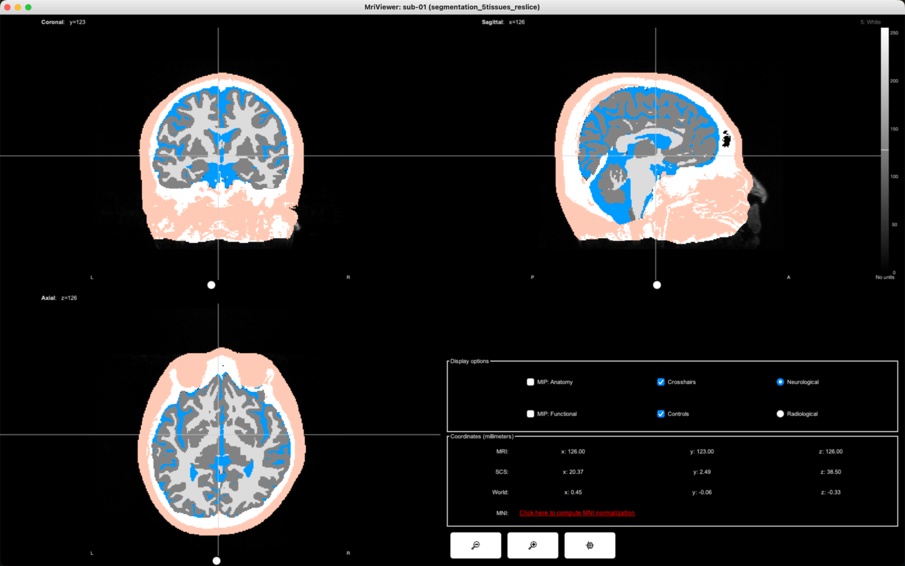
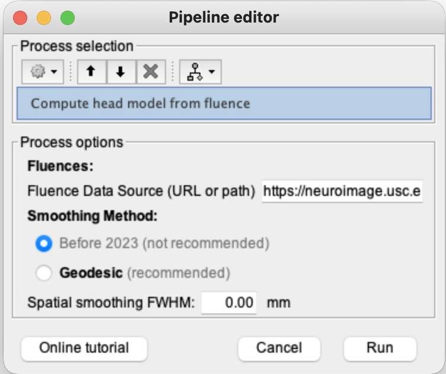
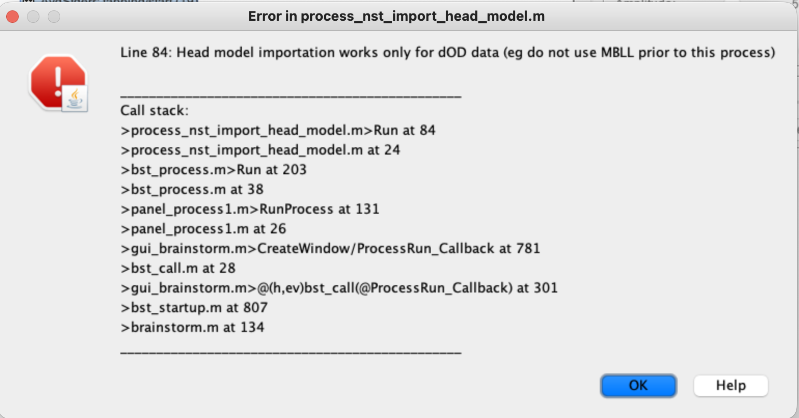
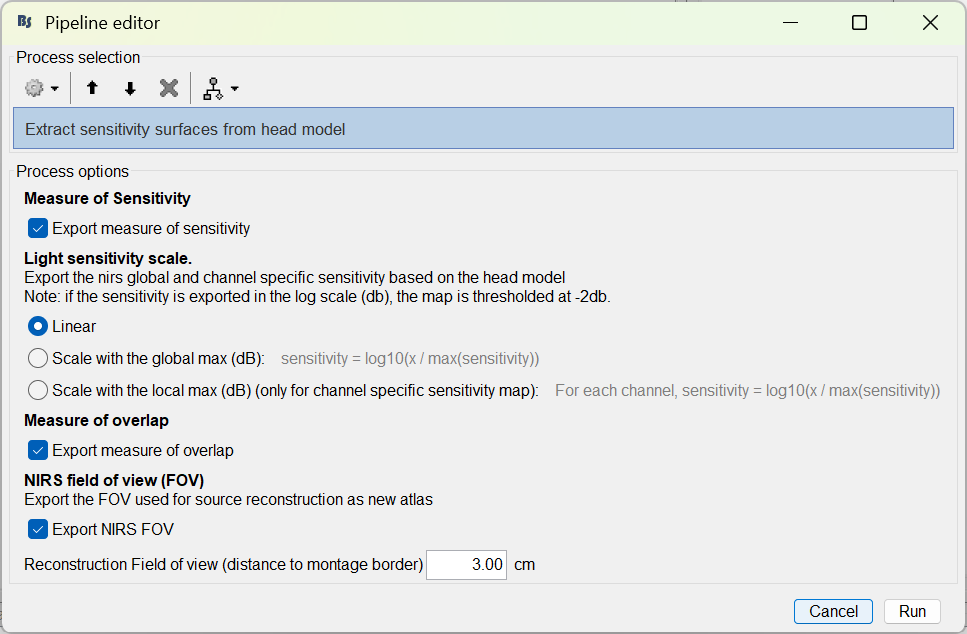
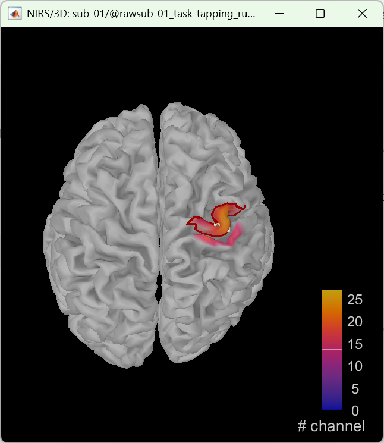

# Lesson 15 — Sensitivity mapping and optical head model

<strong>Status</strong> Complete after Windows rerun

<strong>Input</strong> Wavelength-specific dOD + anatomy + fluences

<strong>Output</strong> NIRS head model and sensitivity maps

## Aim

Build the optical forward model that describes where each source–detector measurement is sensitive in the head. This is a physical measurement model—not a task-activation map.

## Where this lesson branches

The channel-level Hb pathway from Lessons 11–14 remains valid for time-series analysis. Cortical reconstruction requires an additional wavelength-domain branch:

> Registered montage + five-tissue anatomy + wavelength-specific dOD + compatible fluences → NIRS head model.

## Part A — Prepare the anatomy

### 1. Import the five-tissue segmentation

1. Switch to the **Anatomy** view.
2. Right-click the participant and choose **Import MRI**.
3. Browse to `segmentation_5tissues.nii` and click **Choose**.

<figure><figcaption>Open the volume-import command for sub-01.</figcaption></figure>
<figure><figcaption>Select `segmentation_5tissues.nii`.</figcaption></figure>

### 2. Register and reslice the volume

1. In the registration prompt, select the method used by the already registered anatomy; our run retained the existing reference alignment.
2. When asked to reslice the volume to match the MRI alignment, click **Yes**.
3. Inspect the axial, coronal and sagittal overlays for plausible tissue alignment.

<figure><figcaption>Choose the appropriate registration route.</figcaption></figure>
<figure><figcaption>Reslice the segmentation to the reference MRI grid.</figcaption></figure>

### 3. Rename and compute the Voronoi interpolator

1. Right-click the imported volume.
2. Choose **File → Rename** and use a clear name such as `segmentation_5tissues`.
3. Place the required participant data in Process1.
4. Open **NIRS → Sources → Compute Voronoi volume-to-cortex interpolator**.
5. Select **Grey matter masking** and set the atlas/volume to `segmentation_5tissues`.
6. Click **Run**.

<figure><figcaption>Right-click → File → Rename.</figcaption></figure>
<figure><figcaption>Grey-matter-masked volume-to-cortex interpolation.</figcaption></figure>

## Part B — Compute the optical head model

### 4. Select the correct dOD input

Use a wavelength-specific **dOD** file with the registered montage. Do not use an Hb-only result: the head model needs wavelength measurements and their geometry.

### 5. Open Compute head model from fluence

1. Click **Run**.
2. Open **NIRS → Sources → Compute head model from fluence**.
3. Point **Fluence Data Source** to the compatible fluence directory.
4. Select **Geodesic (recommended)**.
5. Set **Spatial smoothing FWHM = 10.00 mm**.
6. Click **Run**.

### 6. Understand the fluence error we encountered

The first run failed because the available fluence set did not contain the exact montage vertices requested by the process. Do not rename a nearby file to imitate a missing vertex: vertex numbers refer to different spatial locations.

### 7. Repeat on Windows with the generated compatible fluences

On the Windows computer we:

1. Loaded the transferred Brainstorm protocol.
2. Selected the wavelength-domain dOD input.
3. Pointed the process to the folder containing the generated fluence files for this montage.
4. Re-ran **Compute head model from fluence** with geodesic 10 mm smoothing.
5. Continued only after the run returned without an error.

<figure><figcaption>The correct wavelength-domain input.</figcaption></figure>
<figure><figcaption>The compatible fluence directory and smoothing settings.</figcaption></figure>

### 8. Extract and display sensitivity measures

Run **Extract sensitivity surfaces from head model**. Choose the required measure—coverage, overlap, channel sensitivity or summed sensitivity—and inspect the outputs for both wavelengths (685 and 830 nm).

<figure><figcaption>Coverage: cortex sampled by the montage.</figcaption></figure>
<figure><figcaption>Overlap: where measurement sensitivities overlap.</figcaption></figure>

## What these maps mean

- **Coverage** shows where the montage provides modeled sensitivity.
- **Overlap** shows areas sampled by multiple measurements.
- **Sensitivity** describes the modeled photon path contribution.
- **Summed sensitivity** aggregates sensitivity across measurements.

None of these is evidence of tapping activation.

## Checkpoint

- Five-tissue segmentation is registered and named.
- The grey-matter Voronoi interpolator exists.
- The input is wavelength-specific dOD.
- The fluence set matches the montage vertices.
- A NIRS head model and 685/830 nm sensitivity outputs exist.

## Troubleshooting

| Problem | Meaning and response |
|---|---|
| Missing fluence vertex | Obtain or generate the exact compatible fluence set; do not rename another vertex file. |
| No NIRS head model appears | Confirm the process completed and the correct dOD folder is selected. |
| Sensitivity map mistaken for activation | Remember that it is a forward-model property, independent of tapping responses. |

## Self-check {.quiz}

**1. What does a light-sensitivity map represent?**  
A. Modeled photon sensitivity through tissue  
B. Behavioural accuracy  
C. Statistical activation

Reveal answer after attempting
<strong>A.</strong> It describes where the optical measurement is physically sensitive.

**2. Which data domain enters the optical model?**  
A. Wavelength-specific dOD  
B. HbO only  
C. MRI time series

Reveal answer after attempting
<strong>A.</strong> The model requires wavelength measurements and montage geometry.

**3. Why must a missing fluence file not be replaced by renaming a nearby one?**  
A. Vertex numbers represent different spatial locations  
B. Names never matter  
C. It changes only colour

Reveal answer after attempting
<strong>A.</strong> Renaming would assign the wrong simulated location to a measurement.

**4. What smoothing was used?**  
A. Geodesic, 10 mm FWHM  
B. Temporal, 10 seconds  
C. No smoothing

Reveal answer after attempting
<strong>A.</strong> The successful process used geodesic smoothing with 10 mm FWHM.

**5. Does high sensitivity prove task activation?**  
A. Yes  
B. No  
C. Only at 830 nm

Reveal answer after attempting
<strong>B.</strong> Sensitivity is a property of measurement physics, not experimental response.

